# Binding with Grammar

[vscode-xml](https://github.com/redhat-developer/vscode-xml) provides support for automatic XML schema/grammar binding through generation and/or using an existing `.xsd/.dtd/.rng/.rnc` file.

> **Tip:** You can also [generate a grammar from an XML document](GenerateGrammarFromXML.md) or [generate an XML document from a grammar](GenerateXMLFromGrammar.md).

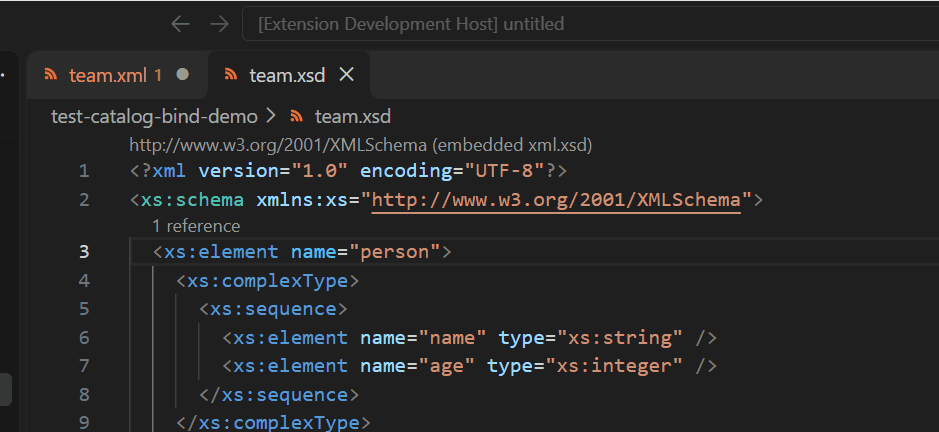

[Validation with XSD grammar](Validation.md#validation-with-xsd-grammar) and [Validation with DTD grammar](Validation.md#validation-with-dtd-grammar) provide more information on manual binding of an XML document.

The binding wizard can be triggered by [Command](#command), [CodeLens](#codelens), or [Quick Fix](#quick-fix).

In the following sections, we would like to bind the XML document `team.xml` with a grammar file.

Consider an XSD document, `team.xsd` (in the same directory as `team.xml`), that declares **two root elements** (`person` and `team`):

```xml
<?xml version="1.0" encoding="UTF-8"?>
<xs:schema xmlns:xs="http://www.w3.org/2001/XMLSchema">
  <xs:element name="person">
    <xs:complexType>
      <xs:sequence>
        <xs:element name="name" type="xs:string" />
        <xs:element name="age" type="xs:integer" />
      </xs:sequence>
    </xs:complexType>
  </xs:element>
  <xs:element name="team">
    <xs:complexType>
      <xs:sequence>
        <xs:element name="name" type="xs:string" />
        <xs:element ref="person" maxOccurs="unbounded" />
      </xs:sequence>
    </xs:complexType>
  </xs:element>
</xs:schema>
```

a DTD document, `team.dtd` (in the same directory as `team.xml`):

```dtd
<!ELEMENT person (name, age)>
<!ELEMENT team (name, person+)>
<!ELEMENT name (#PCDATA)>
<!ELEMENT age (#PCDATA)>
```

and a RelaxNG document, `team.rng` (in the same directory as `team.xml`):

```xml
<?xml version="1.0" encoding="UTF-8"?>
<grammar xmlns="http://relaxng.org/ns/structure/1.0">
  <start>
    <choice>
      <ref name="person"/>
      <ref name="team"/>
    </choice>
  </start>
  <define name="person">
    <element name="person">
      <element name="name"><text/></element>
      <element name="age"><text/></element>
    </element>
  </define>
  <define name="team">
    <element name="team">
      <element name="name"><text/></element>
      <oneOrMore>
        <ref name="person"/>
      </oneOrMore>
    </element>
  </define>
</grammar>
```

or equivalently in RelaxNG Compact syntax, `team.rnc`:

```rnc
start = person | team

person = element person {
  element name { text },
  element age { text }
}

team = element team {
  element name { text },
  person+
}
```

After opening the binding wizard, a dropdown with 3 options appears at the Command Palette:

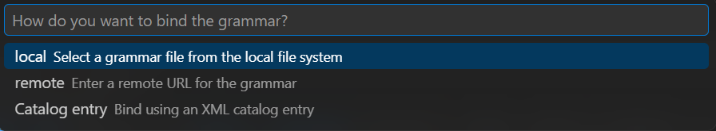

For Standard and XML Model options, a file explorer lets you select the grammar file:

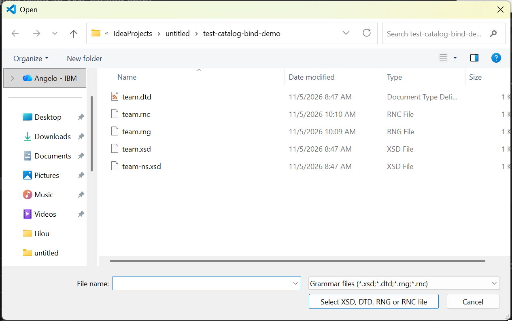

## Standard (xsi, DOCTYPE)

### XSD binding

If the selected file is an XSD file, this option binds the grammar by adding the `xmlns:xsi` (with the value `http://www.w3.org/2001/XMLSchema-instance`) and `xsi:noNamespaceSchemaLocation` (with the path to the grammar file) attributes to the root tag.

Since `team.xsd` declares **two root elements** (`person` and `team`), vscode-xml uses a **SnippetTextEdit** with a [choice placeholder](https://microsoft.github.io/language-server-protocol/specifications/lsp/3.17/specification/#snippet_syntax), letting you pick the root element directly in the editor:

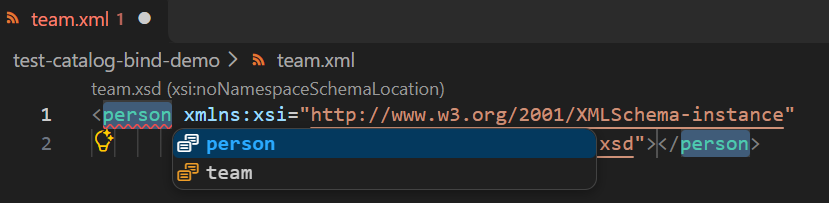

After selecting `person`:
```xml
<person xmlns:xsi="http://www.w3.org/2001/XMLSchema-instance"
        xsi:noNamespaceSchemaLocation="team.xsd"></person>
```

> **Note:** If the XSD declares a single root element, a regular TextEdit is used directly without the choice dropdown.

### With targetNamespace

If the XSD declares a `targetNamespace` with `elementFormDefault="qualified"`:
```xml
<xs:schema xmlns:xs="http://www.w3.org/2001/XMLSchema"
           targetNamespace="http://example.org/team"
           elementFormDefault="qualified">
```
then the binding uses `xmlns` and `xsi:schemaLocation` instead:
```xml
<person xmlns="http://example.org/team"
        xmlns:xsi="http://www.w3.org/2001/XMLSchema-instance"
        xsi:schemaLocation="http://example.org/team team-ns.xsd"></person>
```

### DTD binding

If the selected file is a DTD file, this option adds a `<!DOCTYPE>` declaration at the beginning of the document:

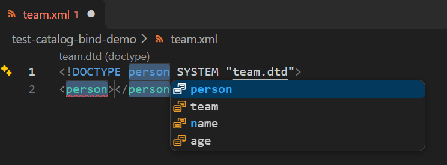

After selecting `team`:
```xml
<!DOCTYPE team SYSTEM "team.dtd">
<team></team>
```

## XML Model association

This option binds the grammar by adding an `<?xml-model?>` processing instruction at the beginning of the document:

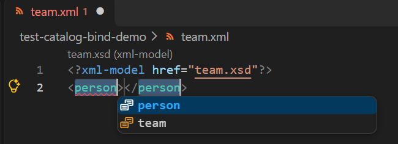

After selecting `person` with an XSD file:
```xml
<?xml-model href="team.xsd"?>
<person></person>
```

The same applies when selecting a DTD file:
```xml
<?xml-model href="team.dtd"?>
<team></team>
```

### RelaxNG binding

When selecting a RelaxNG file (`.rng` or `.rnc`), the `<?xml-model?>` processing instruction:

For a `.rng` (XML syntax) file:
```xml
<?xml-model href="team.rng"?>
<team></team>
```

For a `.rnc` (Compact syntax) file:
```xml
<?xml-model href="team.rnc"?>
<team></team>
```

> **Note:** RelaxNG grammars can only be bound via XML Model or Catalog entry, not via Standard (xsi, DOCTYPE).

## Catalog entry

This option binds the XML document through an [XML Catalog](https://www.oasis-open.org/committees/entity/spec-2001-08-06.html). An XML Catalog is a mapping file that redirects XML identifiers (public IDs, system IDs, URIs) to local grammar resources, allowing you to manage grammar bindings centrally rather than embedding paths in each XML file.

When you select this option, the wizard presents two choices:

### Pick an existing catalog entry

If your workspace has registered catalogs (via the `xml.catalogs` setting) that already contain entries, they are listed grouped by catalog file. Selecting an entry inserts the appropriate binding in your XML document (DOCTYPE for public/system entries, xsi:schemaLocation for XSD entries).

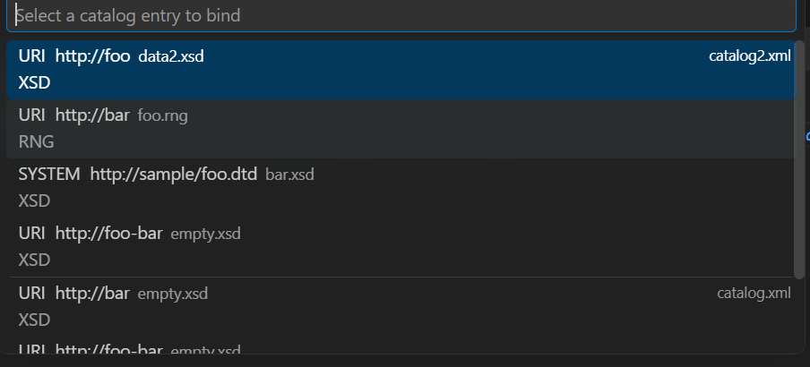

With multiple root elements, the choice placeholder lets you select the root element, just like with Standard and XML Model options.

### Add a new catalog entry

If no existing entry matches, select "Add new catalog entry..." at the bottom of the list. 

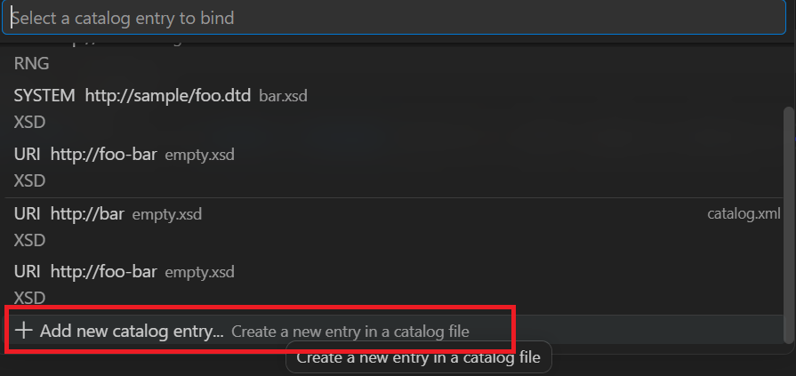

The wizard will:

1. Ask which catalog should contain the new entry (an existing registered catalog, browse for another catalog file, or create a new catalog file)

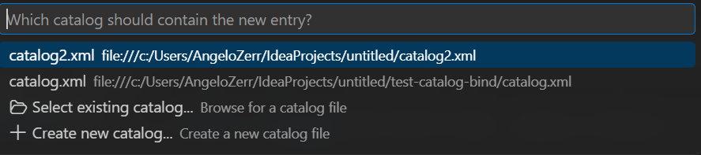

2. Ask for the entry type (`public`, `system`, or `uri`)
3. Ask for the identifier (the public ID, system ID, or namespace URI)
4. Let you select the grammar file

The entry is added to the catalog file, the catalog is registered in `xml.catalogs` if needed, and the XML document is bound using the catalog entry.

For example, with a `public` catalog entry, the resulting binding is a PUBLIC DOCTYPE:
```xml
<!DOCTYPE team PUBLIC "-//Example//DTD Team//EN" "team.dtd">
<team></team>
```

With a `uri` catalog entry pointing to an XSD with a target namespace, the result uses `xsi:schemaLocation`:
```xml
<person xmlns="http://example.org/team"
        xmlns:xsi="http://www.w3.org/2001/XMLSchema-instance"
        xsi:schemaLocation="http://example.org/team team-ns.xsd"></person>
```

> **Note:** The generated catalog entry respects your formatting settings (indentation, tab/spaces, space before empty close tag).

## Triggers

The binding wizard can be triggered in three ways:

### Command

The command "XML: Bind to grammar/schema file" can be executed from the VSCode command palette, as well as be bound to a shortcut.

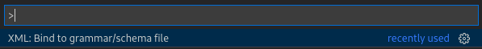

If the current XML document already has a bound grammar/schema, an error will be shown.

### CodeLens

When [CodeLenses](./Preferences.md#code-lens) are enabled, an unbound XML document will display a CodeLens above the root element:

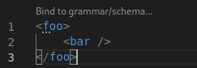

### Quick Fix

For any unbound XML document, a Quick Fix suggestion will appear beside the root element.

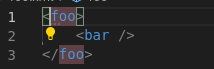

With the cursor on the first opening tag, use `Ctrl + .`, `Quick Fix...` or the lightbulb that appears and select "Bind to existing grammar/schema":

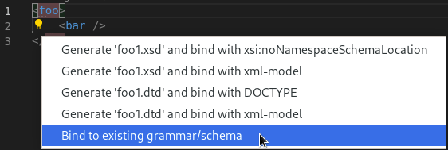

## Binding with New Grammar

If no grammar file exists yet, you can generate one from the XML document and bind it in one step.

See [Generate Grammar from XML](GenerateGrammarFromXML.md) for the full documentation (command wizard, Quick Fix, examples).
