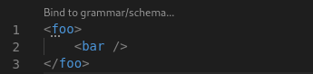
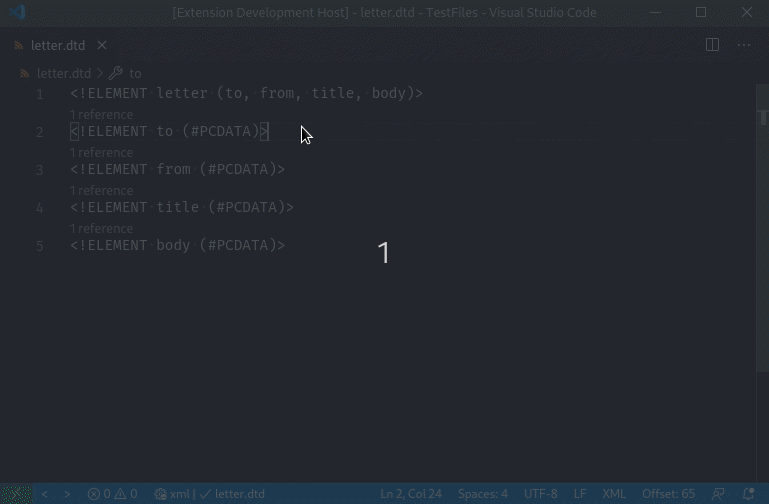
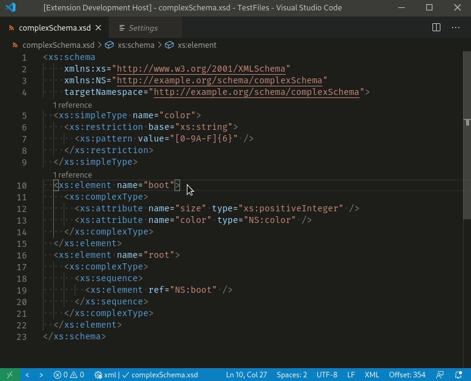

## Code Lens

### XML Features

CodeLens provides grammar binding for unbound XML documents, appearing above the root element, which will trigger the [XML Binding Wizard](BindingWithGrammar.md#the-xml-binding-wizard).



### DTD features

Code lens is provided in `.dtd` files to show where elements defined in the DTD are referenced.
For instance, in the following code:

```xml
<!ELEMENT letter (to, from, title, body)>
<!ELEMENT to (#PCDATA)>
<!ELEMENT from (#PCDATA)>
<!ELEMENT title (#PCDATA)>
<!ELEMENT body (#PCDATA)>
```

There will be a code lens entry after the first line that points from the
definition of the element `to` to where it is used in the definition of the
element `letter`.

Here is a demonstration of the above Code Lens:



### XSD Features

Code lens is also provided in `.xsd` files. It shows where top level types
and elements are referenced. For instance, in the following code:

```xml
<?xml version="1.0" encoding="UTF-8"?>
<xs:schema
    xmlns:xs="http://www.w3.org/2001/XMLSchema"
    targetNamespace="http://example.org/my-example"
    xmlns:NS="http://example.org/my-example">
  <xs:element
      name="root-element"
      type="NS:yell" />
  <xs:simpleType name='yell'>
    <xs:restriction base='xs:string'>
      <xs:pattern value='[A-Z]+!'></xs:pattern>
    </xs:restriction>
  </xs:simpleType>
</xs:schema>
```

There will be a code lens above the line where the `yell` type is defined
that points to where it is referenced when defining the `root-element` element.

Here is a demonstration of the above Code Lens:


Here is a demonstration of the code lens for `xs:element`:



### Grammar file references (Workspace Index)

When [Workspace Index](WorkspaceIndex.md) is enabled (`"xml.workspaceIndex.enabled": true`) **and** code lens is enabled (`"xml.codeLens.enabled": true`), grammar files (`.xsd`, `.dtd`, `.rng`, `.rnc`) show a **"N references"** code lens above the root element, indicating how many XML files in the workspace reference that grammar file.

<!-- TODO: add screenshot here (WorkspaceIndexCodeLens.png) -->

Click the code lens (or use **Find All References** with the cursor inside the grammar file) to open the References panel listing every XML file and the exact line of each reference.

You can also trigger this lookup without code lens via **right-click → Find References** on a grammar file in the Explorer or editor context menu. This entry is always visible for grammar files. If the Workspace Index is not yet enabled, clicking it will offer to enable it automatically; accepting enables the index and immediately opens the References panel for that file.

This is distinct from the XSD/DTD code lenses above, which show references *within* the grammar file itself. The workspace index code lens shows references *from XML files* to the grammar file as a whole.

See [Workspace Index](WorkspaceIndex.md) for setup and details.

### Catalog entry references (Workspace Index)

When [Workspace Index](WorkspaceIndex.md) is enabled **and** code lens is enabled, each `<uri>`, `<system>`, and `<public>` entry in a registered XML catalog shows a **"N references"** code lens indicating how many XML files use that catalog mapping.

<!-- TODO: screenshot CodeLensCatalogEntryReferences.png -->

The count is based on the catalog identifier (`name`, `systemId`, or `publicId`) — the value that XML files use to bind to the grammar (via `xmlns=`, `SYSTEM`, or `PUBLIC`), not the grammar filename.

Click the code lens to open the References panel listing all XML files that reference that catalog mapping.

See [XML Catalog Features — References on Catalog Entries](Features/XMLCatalogFeatures.md#references-on-catalog-entries) for full details.
