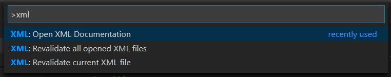

# Commands

[vscode-xml](https://github.com/redhat-developer/vscode-xml) provides commands accessible from the **command palette** (`Ctrl+Shift+P`), the **editor context menu** (right-click in the editor), and the **explorer context menu** (right-click on a file).

## Context Menu

Right-clicking in an XML or grammar file editor shows an **XML** section in the context menu with the following entries:

| Menu entry | Available on | Description |
|---------|-------------|-------------|
| [Surround with Tags](Refactor.md#surround-with-tags-wrap) | XML files | Wrap selection with an XML tag |
| [Surround with Comments](Refactor.md#surround-with-comments) | XML files | Comment out the selection |
| [Surround with CDATA](Refactor.md#surround-with-cdata) | XML files | Wrap selection with CDATA |
| [Surround with Ignore Formatting](Refactor.md#surround-with-ignore-formatting) | XML files | Wrap selection to preserve formatting |
| [Minify XML Document](#minify-xml-document) | XML files | Remove unnecessary whitespace |
| [Generate Grammar from XML](GenerateGrammarFromXML.md) | XML files (no grammar bound) | Generate a grammar and bind it |
| [Generate XML from Grammar](GenerateXMLFromGrammar.md) | Grammar files (`.xsd`, `.dtd`, `.rng`, `.rnc`) | Generate an XML document |

The Generate commands are also available from the **Explorer** context menu (right-click on a file). All commands are available from the command palette.

## Generation

Generation works in both directions:

- [**Generate XML from Grammar**](GenerateXMLFromGrammar.md): generate a complete XML document from a grammar file (XSD, DTD, RelaxNG, RNC)
- [**Generate Grammar from XML**](GenerateGrammarFromXML.md): generate a grammar from an existing XML document and bind it (XSD, DTD, RelaxNG, RNC)

## Binding

### Bind to grammar/schema file

Triggers the [XML Binding Wizard](BindingWithGrammar.md#the-xml-binding-wizard) to associate an existing grammar file to the current XML document.

Available from:
- Command palette: **XML: Bind to grammar/schema file**

See [Binding with Grammar](BindingWithGrammar.md) for details.

## Refactoring

The Surround with commands wrap selected XML content with tags, comments, CDATA, or ignore-formatting markers.

Available from:
- Command palette
- Editor context menu (on XML files)

See [Refactor](Refactor.md) for details and demos.

## Minify XML Document

Minifies the current XML document by removing unnecessary whitespace while preserving the document's structure and content.

Available from:
- Command palette: **XML: Minify XML Document**
- Editor context menu (on XML files)

The minification process:
- Removes all indentation and line breaks between elements
- Removes whitespace between the XML declaration and the root element
- Normalizes whitespace sequences inside text content to a single space
- Preserves whitespace in elements with `xml:space="preserve"` attribute
- Preserves content in CDATA sections
- Reduces multiple spaces between attributes to a single space

## Validation

### Revalidate current XML file

Re-triggers the [XML Validation](Validation.md#xml-validation) for the current file.

When the [Server Cache Path](Preferences.md#server-cache-path) is activated, the command removes the referenced XSD, DTD grammar from the local cache.

Available from:
- Command palette: **XML: Revalidate current XML file**

### Revalidate all open XML files

Re-triggers the [XML Validation](Validation.md#xml-validation) for all opened XML files.

When the [Server Cache Path](Preferences.md#server-cache-path) is activated, the command clears the remote grammar cache and revalidates all opened files.

Available from:
- Command palette: **XML: Revalidate all open XML files**

## Other

### Open XML Documentation

Opens the XML Documentation.

### Restart XML Language Server

Restarts the XML language server.
