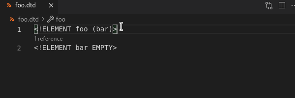
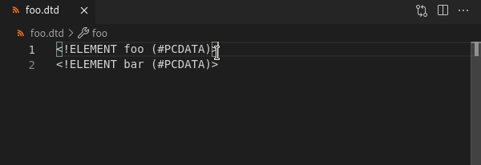
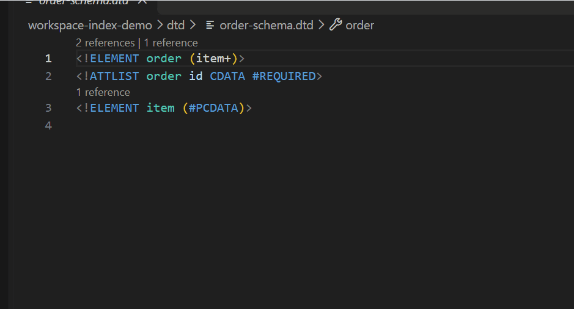

# DTD Features

## Binding

See [Binding with Grammar](../BindingWithGrammar.md#dtd-binding) to associate an XML file with a DTD using the binding wizard.

## Syntax Validation

DTD syntax validation is enabled for any `.dtd` file.



## CodeLens Support

CodeLens is supported for `.dtd` files, which can show where an element declaration is referenced.



This feature also supports listing and highlighting the number of references to an element declaration and the line(s) referenced on.


### Read more

See [CodeLens](../CodeLens.md#code-lens) for more details.

## Category Accessibility

After defining an `!ELEMENT` tag in the `.dtd` file, there are features available for categories.

### Jump to element declaration

For an `!ELEMENT` tag that contains a category/element-content attribute, there is support for navigating to its definition element.


## Workspace Index

When [Workspace Index](../WorkspaceIndex.md) is enabled (`"xml.workspaceIndex.enabled": true`), DTD grammar files gain two additional cross-file features.



### Sample files

Consider a workspace with one DTD grammar, a second DTD that includes it, and two XML files that reference it in different ways:

**`order-schema.dtd`**
```dtd
<!ELEMENT order (item+)>
<!ATTLIST order id CDATA #REQUIRED>
<!ELEMENT item (#PCDATA)>
```

**`order-schema-extended.dtd`** — includes the base DTD via entity
```dtd
<!ENTITY % order-schema SYSTEM "order-schema.dtd">
%order-schema;

<!ELEMENT orders (order+)>
```

**`order-system.xml`** — references the DTD via `SYSTEM`
```xml
<!DOCTYPE order SYSTEM "order-schema.dtd">
<order id="1">
  <item>Widget</item>
</order>
```

**`order-public.xml`** — references the DTD via `PUBLIC`
```xml
<!DOCTYPE order PUBLIC "-//Example//DTD Order//EN" "order-schema.dtd">
<order id="2">
  <item>Gadget</item>
</order>
```

**`orders-extended.xml`** — references the extended DTD
```xml
<!DOCTYPE orders SYSTEM "order-schema-extended.dtd">
<orders>
  <order id="1"><item>Widget</item></order>
  <order id="2"><item>Gadget</item></order>
</orders>
```

Opening `order-schema.dtd` shows a **"2 references"** code lens (the two XML files that reference it directly). `order-schema-extended.dtd` also shows as a referencing file since it includes `order-schema.dtd` via the entity declaration.

### Code lens — N references

A **"N references"** code lens appears above the root element of the `.dtd` file, showing how many XML files in the workspace reference it. Click it (or use **Find All References**) to open the References panel with the exact location of each reference.

> **Prerequisite:** Code lens must also be enabled — set `"xml.codeLens.enabled": true`.

<!-- TODO: add screenshot here (WorkspaceIndexCodeLensDTD.png) -->

### Rename grammar file

Renaming a `.dtd` file in the VS Code Explorer automatically updates all XML files that reference it (via `<!DOCTYPE ... SYSTEM "...">` or `<?xml-model?>`).

See [Workspace Index](../WorkspaceIndex.md) for full setup and details.
