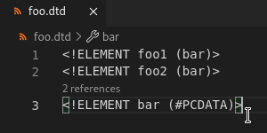
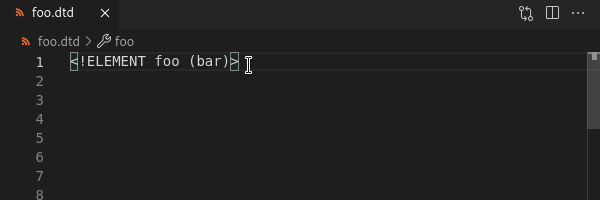

# DTD Features

## Binding

See [Binding with Grammar](../BindingWithGrammar.md#dtd-binding) to associate an XML file with a DTD using the binding wizard.

## Syntax Validation

DTD syntax validation is enabled for any `.dtd` file.

## CodeLens Support

CodeLens is supported for `.dtd` files, which can show where an element declaration is referenced.

This feature also supports listing and highlighting the number of references to an element declaration and the line(s) referenced on.

### Read more

See [CodeLens](../CodeLens.md#code-lens) for more details.

## Category Accessibility

After defining an `!ELEMENT` tag in the `.dtd` file, there are features available for categories.

### Jump to element declaration

For an `!ELEMENT` tag that contains a category/element-content attribute, there is support for navigating to its definition element.

## Workspace Index

When [Workspace Index](../WorkspaceIndex.md) is enabled (`"xml.workspaceIndex.enabled": true`), DTD grammar files gain two additional cross-file features.

### Code lens — N references

A **"N references"** code lens appears above the root element of the `.dtd` file, showing how many XML files in the workspace reference it. Click it (or use **Find All References**) to open the References panel with the exact location of each reference.

> **Prerequisite:** Code lens must also be enabled — set `"xml.codeLens.enabled": true`.

<!-- TODO: add screenshot here (WorkspaceIndexCodeLensDTD.png) -->

### Rename grammar file

Renaming a `.dtd` file in the VS Code Explorer automatically updates all XML files that reference it (via `<!DOCTYPE ... SYSTEM "...">` or `<?xml-model?>`).

See [Workspace Index](../WorkspaceIndex.md) for full setup and details.
