# RNC (RELAX NG Compact Syntax) Features

[vscode-xml](https://github.com/redhat-developer/vscode-xml) provides comprehensive language support for [RELAX NG Compact Syntax (*.rnc files)](https://relaxng.org/compact-tutorial-20030326.html).

This page walks through the features by building an RNC grammar step by step.

## Creating a new grammar

Open an empty `.rnc` file and type `default`. The completion list shows snippets to bootstrap a new grammar with namespace and datatype declarations:

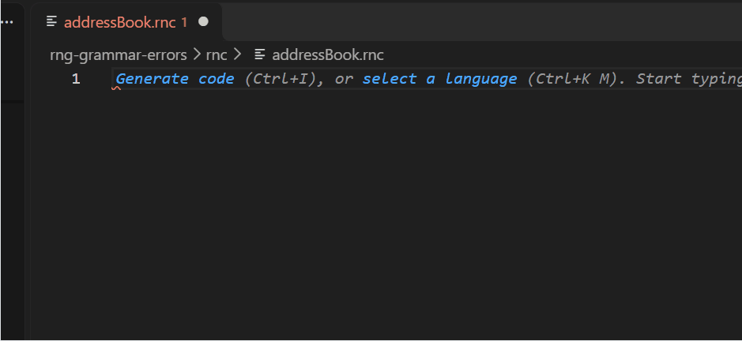

Select **New RelaxNG Compact with namespace and define** to insert:

```rnc
default namespace = "http://example.com"
datatypes xsd = "http://www.w3.org/2001/XMLSchema-datatypes"

start = root

root = element root {
  
}
```

The cursor lands on the namespace URI so you can type your namespace, then press `Tab` to jump to the element name, and `Tab` again to jump inside the braces.

## Writing a simple element

Type `element` to get the element snippet, type the element name, then use the **Insert text** quick fix (`Ctrl+.`) on the empty `{ }`:


This gives you:

```rnc
element addressBook { text }
```

## Building a grammar with defines

Now let's build a real grammar. Type `start` to get the completion for the `start` pattern, add elements and defines, and use define reference completion to reference existing patterns:

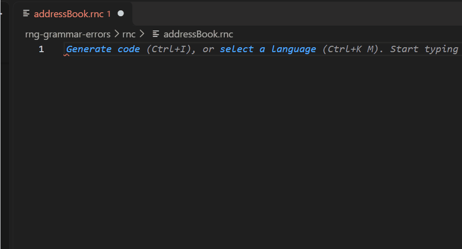

This gives you:

```rnc
start = element addressBook {
  element card {
    text
  },
  email2
}

start |= email2

email2 = element email {
  text
}
```

## Completion

Completion is context-aware and adapts to the cursor position.

### In an empty file

At the top level, completion suggests declaration keywords (`namespace`, `default`, `datatypes`, `start`, `include`, `div`) and snippets:

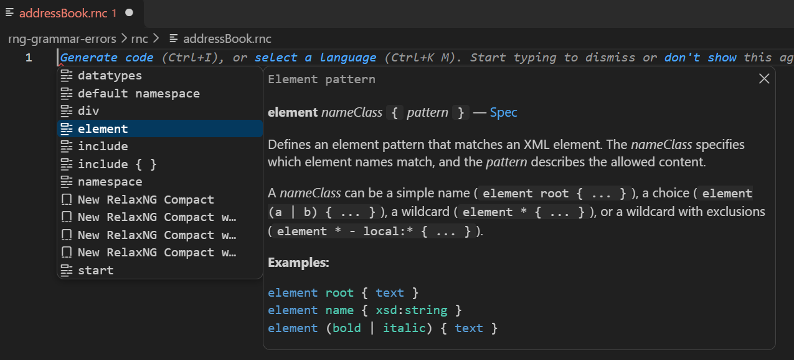

### Inside an element

Inside `{ }`, completion suggests pattern keywords (`element`, `attribute`, `text`, `empty`, `mixed`, `list`) and defined pattern references:

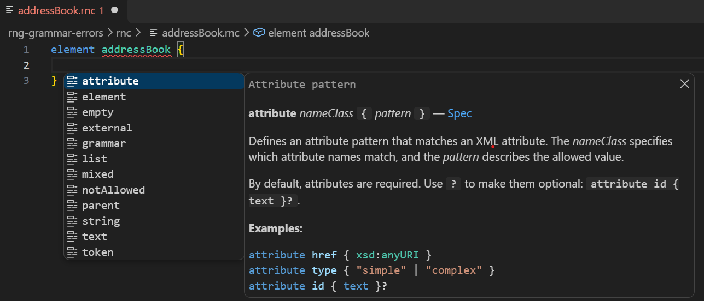

## Diagnostics

RNC validation reports parser errors with precise ranges. For example, a missing `{` or a typo in a keyword is underlined at the exact location:

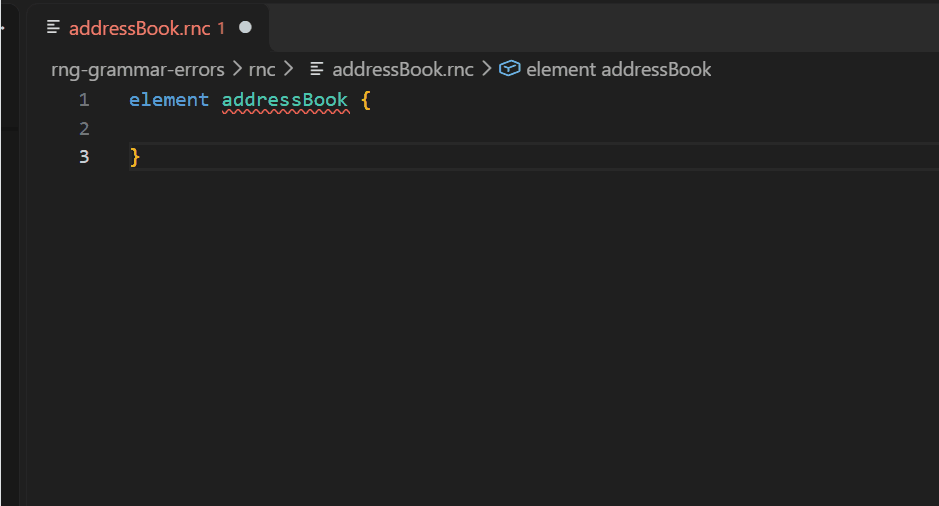

### Unused define patterns

Defines that are never referenced are reported with a hint diagnostic and shown with a faded style:

```rnc
start = element root { text }

unused = element old { empty }
```

The define `unused` is flagged as unreferenced:

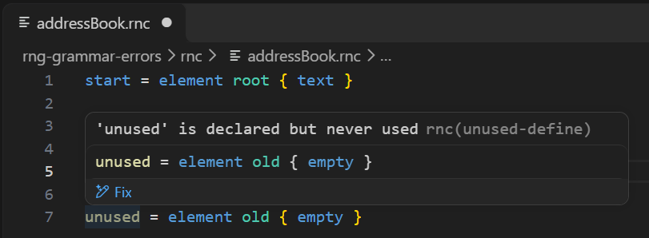

## Code Actions

Quick fixes are available for common errors. Click the lightbulb or press `Ctrl+.` to see suggestions:

### Missing `{`

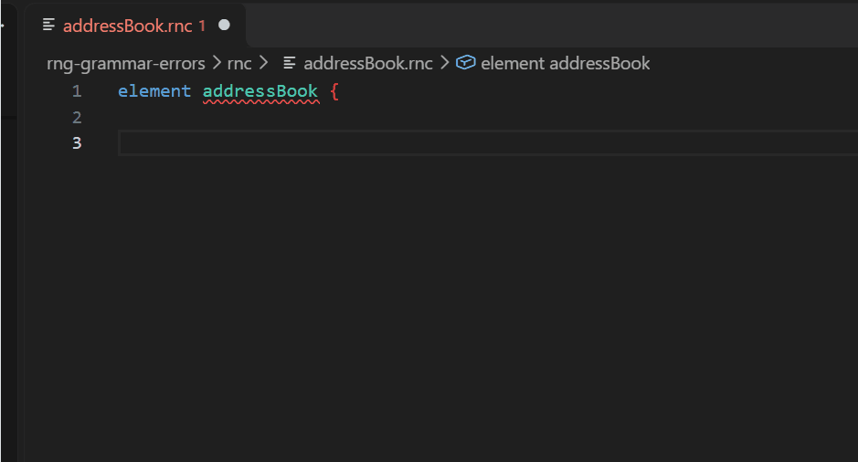

### Missing pattern

When `{ }` is empty, quick fixes offer to insert `text`, `empty`, an `element`, or an `attribute`:

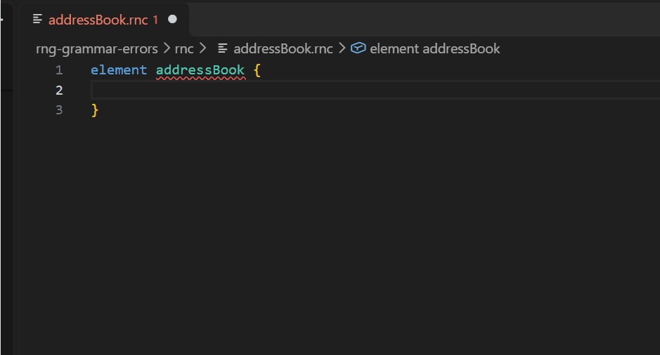

### Undefined pattern

When a reference points to a pattern that doesn't exist, quick fixes suggest similar names ("Did you mean?") and offer to create a new define:

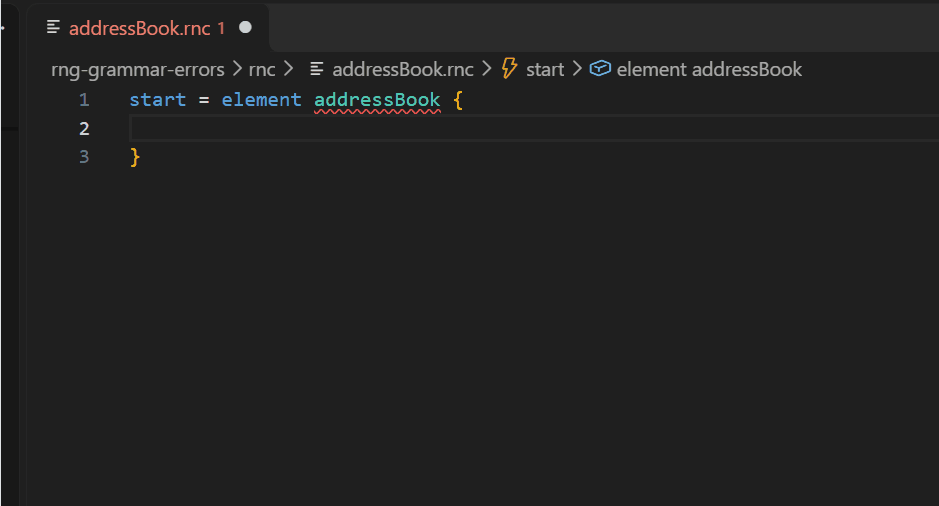

## Include

RNC supports splitting grammars into multiple files with `include`. The following demo shows the full include workflow starting from `valid-include-base.rnc`:

```rnc
start = element doc {
  header, body
}

header = element header {
  element title { text }
}

body = element body { paragraph* }

paragraph = element p { text }
```

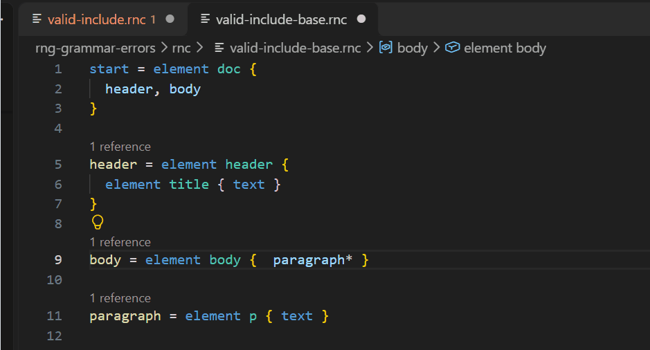


### `include` (reference)

In a new file `valid-include.rnc`, type `include` to get the completion with two variants:

- `include` — inserts `include ""` and automatically triggers file path completion
- `include { }` — inserts `include "" { }` with file path completion

After selecting the file, the included defines become available as references — completion suggests them alongside local defines:

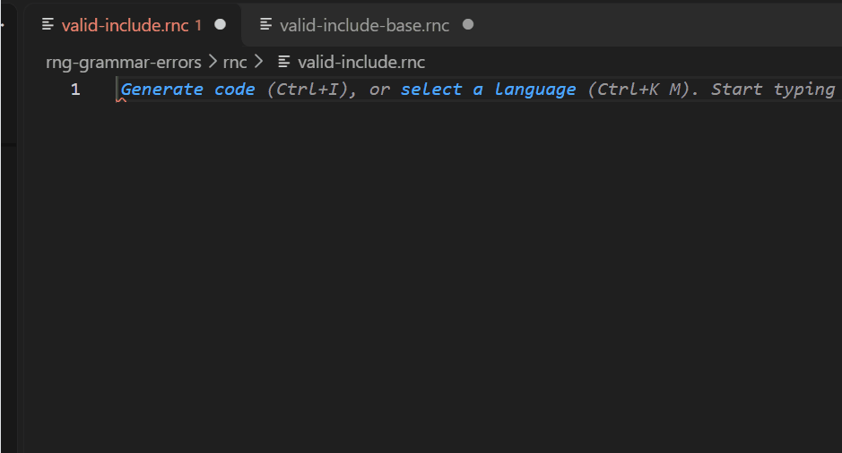

```rnc
include "valid-include-base.rnc"
```

Here `header`, `body`, `paragraph` are references from `valid-include-base.rnc`. If you mistype one (e.g. `paragrap`), the "Did you mean 'paragraph'?" code action suggests the correct name from the included file.

#### Hover on `include`

Hovering over `include` shows the definitions available from the included file:

```
include "valid-include-base.rnc"

Definitions from included file:
- `start` — inherited
- `header` — inherited
- `body` — inherited
- `paragraph` — inherited
```

#### Cross-file navigation

Use `Ctrl+Click` on a define reference to navigate to its definition, even when it is defined in an included file:

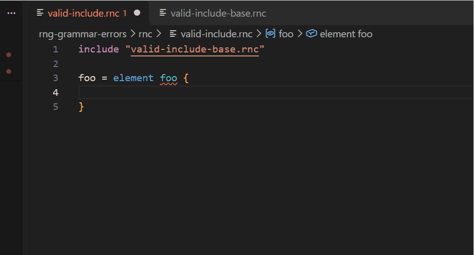

### `include { }` (override)

Use `include "file.rnc" { }` with a body to override specific defines from the included file. Inside the body, `Ctrl+Space` proposes overridable defines with their original text.

#### Override completion

After selecting the file and opening the body with `{ }`, press `Ctrl+Space` to see the defines that can be overridden:

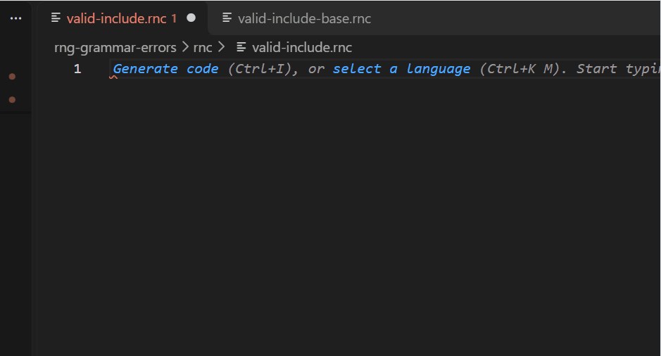

```rnc
include "valid-include-base.rnc" {
  | ← Ctrl+Space shows: start, header, body, paragraph
}
```

Selecting `paragraph` inserts the original definition which you can then modify:

```rnc
include "valid-include-base.rnc" {
  paragraph = element p2 { text }
  body = element body {
    paragraph*
  }
}
```

Here `paragraph` and `body` are overridden with different content models.

#### Hover on `include` with overrides

Hovering over `include` shows which defines are overridden and which are inherited:

```
include "valid-include-base.rnc"

Definitions from included file:
- `start` — inherited
- `header` — inherited
- ~~body~~ — overridden
- ~~paragraph~~ — overridden
```

#### Hover on override define

Hovering over `paragraph` inside the body shows both the **Override** (the local replacement) and the **Original** (from the included file):

```
Override:
  paragraph = element p2 { text }

Original:
  paragraph = element p { text }
```

#### "Did you mean?" for overrides

If you mistype a define name inside the include body (e.g. `paragraphX`), the error "does not override anything" is reported. The code action suggests similar names from the included file:

- "Did you mean 'paragraph'?" — replaces with the correct name

#### Cross-file navigation

`Ctrl+Click` on the override navigates to the original define in the included file.

## Hover

Hovering over a define reference shows the definition content. Hovering over an RNC keyword shows documentation from the RELAX NG specification:

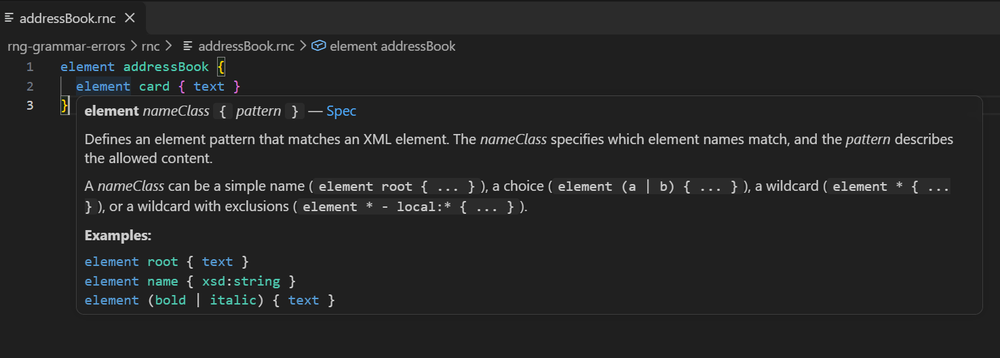

## Find References

Use `Find All References` on a define name to see all locations that reference it.

## Document Highlighting

Placing the cursor on a define name or reference highlights the declaration and all usages in the current document.

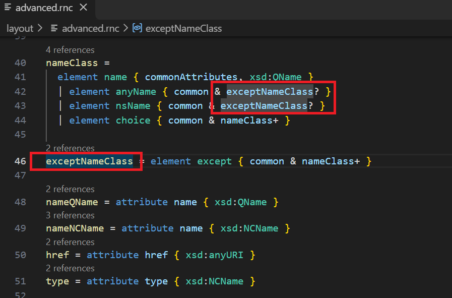

## Rename

Rename a define and all its references by using `Rename Symbol` (`F2`) on a define name or reference.

## Code Lens

Displays the number of references above each define declaration (e.g., `2 references`). Clicking the code lens shows all references:

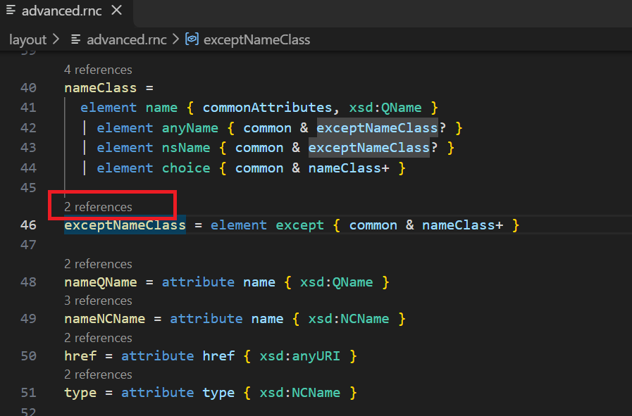

## Go to Definition

Use `Go to Definition` (`F12` or `Ctrl+Click`) on a pattern reference to navigate to its define declaration.

## Document Symbols

The Outline view shows define declarations as symbols, providing a quick overview of the grammar structure:

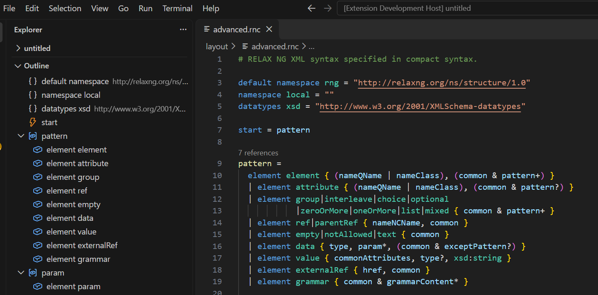

## Folding

Foldable regions are provided for `{ }` brace blocks and consecutive comment groups.

## Formatting

RNC formatting adjusts spacing, indentation, and blank lines while preserving the user's line-breaking choices.

The formatter also respects the standard editor settings (`editor.tabSize`, `editor.insertSpaces`, `files.trimTrailingWhitespace`, `files.insertFinalNewline`, `files.trimFinalNewlines`).

### Spacing around operators

Operators (`=`, `|=`, `&=`, `|`, `&`) get a space before and after. Commas get no space before and a space after. Postfix operators (`?`, `*`, `+`) attach directly to their operand.

Given this RNC:

```rnc
namespace a="http://example.com"
start=element root{a|b,c *}
```

After formatting:

```rnc
namespace a = "http://example.com"

start = element root {
  a | b, c*
}
```

### Single-line blocks

When a `{ }` block with content is written on a single line, the formatter preserves it:

```rnc
start = element root { text }
param = element param { commonAttributes, nameNCName, xsd:string }
```

### Multi-line definitions

When `=` is followed by a newline, the formatter preserves the multi-line layout with proper continuation indentation:

```rnc
pattern =
  element element { (nameQName | nameClass), (common & pattern+) }
  | element attribute { (nameQName | nameClass), (common & pattern?) }
```

### Formatting Settings

| Setting | Type | Default | Description |
|---------|------|---------|-------------|
| `xml.rnc.format.blankLinesBetweenDefines` | integer | `1` | Number of blank lines between top-level definitions. Set to `-1` to preserve existing blank lines. |

## Generate XML from Grammar

Right-click an `.rnc` file in the explorer and select **Generate XML from Grammar**, or use the command palette. The wizard lists the root elements declared in the grammar and generates an XML skeleton:

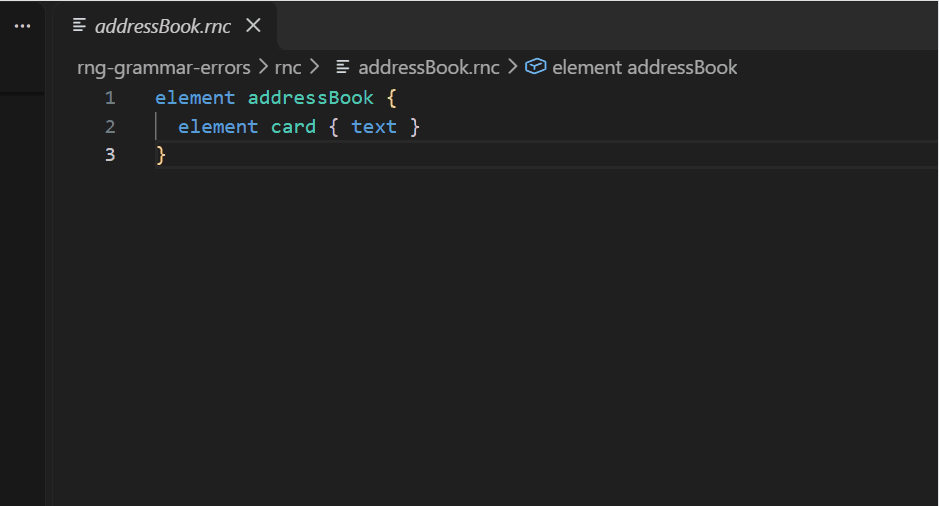

For example, given this grammar:

```rnc
start = element addressBook {
  element card {
    element name { text },
    element email { text }
  }
}
```

Selecting `addressBook` as root element generates:

```xml
<?xml version="1.0" encoding="UTF-8"?>
<addressBook>
  <card>
    <name></name>
    <email></email>
  </card>
</addressBook>
```

See [Generate XML from Grammar](../GenerateXMLFromGrammar.md) for more details.
