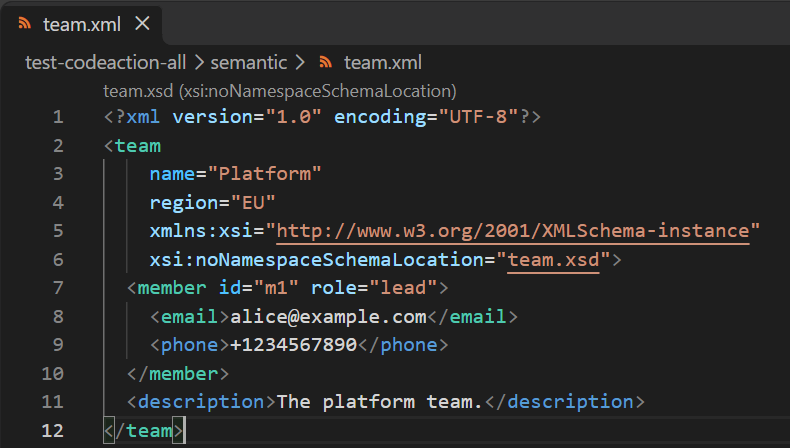
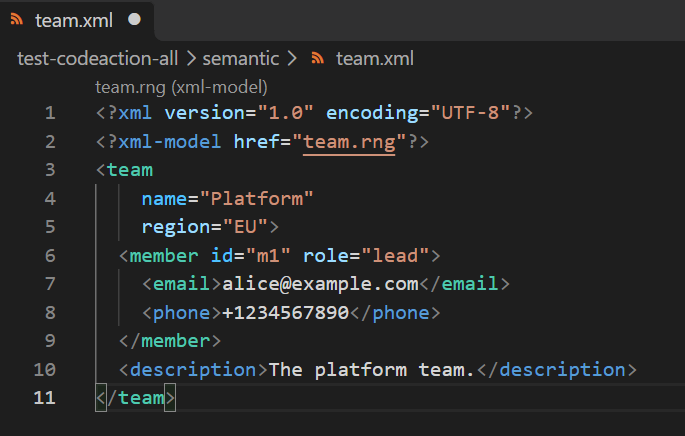
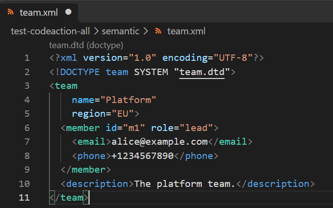

# Semantic Highlighting

When an XML file is associated with a grammar (XSD, RelaxNG, or DTD), [vscode-xml](https://github.com/redhat-developer/vscode-xml) can visually distinguish **required** elements and attributes through semantic highlighting. This makes it easy to see at a glance which parts of the XML structure are mandatory according to the grammar.

## Setting

Semantic highlighting is enabled by default. You can enable/disable it with the `xml.semanticTokens.enabled` setting:

```json
"xml.semanticTokens.enabled": true
```

## XSD

### Given XSD

Given the following `team.xsd` schema which declares a `team` element with a required `name` attribute and required `member` child element:

```xml
<?xml version="1.0" encoding="UTF-8"?>
<xs:schema xmlns:xs="http://www.w3.org/2001/XMLSchema">

  <xs:element name="team" type="teamType" />

  <xs:complexType name="teamType">
    <xs:sequence>
      <xs:element name="member" type="memberType" maxOccurs="unbounded" />
      <xs:element name="description" type="xs:string" minOccurs="0" />
    </xs:sequence>
    <xs:attribute name="name" type="xs:string" use="required" />
    <xs:attribute name="region" type="xs:string" />
  </xs:complexType>

  <xs:complexType name="memberType">
    <xs:sequence>
      <xs:element name="email" type="xs:string" />
      <xs:element name="phone" type="xs:string" minOccurs="0" />
    </xs:sequence>
    <xs:attribute name="id" type="xs:string" use="required" />
    <xs:attribute name="role" type="xs:string" />
  </xs:complexType>

</xs:schema>
```

In this schema:

 * `member` element is **required** (`minOccurs` defaults to `1`), while `description` is optional (`minOccurs="0"`).
 * `name` attribute is **required** (`use="required"`), while `region` is optional.
 * `id` attribute is **required** (`use="required"`), while `role` is optional.

### Given XML

Given the following `team.xml` file associated with the XSD:

```xml
<?xml version="1.0" encoding="UTF-8"?>
<team
    name="Platform"
    region="EU"
    xmlns:xsi="http://www.w3.org/2001/XMLSchema-instance"
    xsi:noNamespaceSchemaLocation="team.xsd">
  <member id="m1" role="lead">
    <email>alice@example.com</email>
    <phone>+1234567890</phone>
  </member>
  <description>The platform team.</description>
</team>
```

### Required elements and attributes

With semantic highlighting, required elements (`member`, `email`) are visually distinguished from optional elements (`description`, `phone`), and required attributes (`name`, `id`) are visually distinguished from optional attributes (`region`, `role`):



## RelaxNG

### Given RelaxNG

Given the following `team.rng` RelaxNG schema:

```xml
<?xml version="1.0" encoding="UTF-8"?>
<grammar xmlns="http://relaxng.org/ns/structure/1.0"
         datatypeLibrary="http://www.w3.org/2001/XMLSchema-datatypes">

  <start>
    <ref name="team" />
  </start>

  <define name="team">
    <element name="team">
      <attribute name="name" />
      <optional>
        <attribute name="region" />
      </optional>
      <oneOrMore>
        <ref name="member" />
      </oneOrMore>
      <optional>
        <element name="description">
          <text />
        </element>
      </optional>
    </element>
  </define>

  <define name="member">
    <element name="member">
      <attribute name="id" />
      <optional>
        <attribute name="role" />
      </optional>
      <element name="email">
        <text />
      </element>
      <optional>
        <element name="phone">
          <text />
        </element>
      </optional>
    </element>
  </define>

</grammar>
```

In this schema:

 * `member` element is **required** (inside `oneOrMore`), while `description` is optional.
 * `name` and `id` attributes are **required** (not wrapped in `optional`), while `region` and `role` are optional.

### Given XML

Given the following `team.xml` file associated with the RelaxNG schema:

```xml
<?xml version="1.0" encoding="UTF-8"?>
<?xml-model href="team.rng"?>
<team
    name="Platform"
    region="EU">
  <member id="m1" role="lead">
    <email>alice@example.com</email>
    <phone>+1234567890</phone>
  </member>
  <description>The platform team.</description>
</team>
```

### Required elements and attributes



## DTD

### Given DTD

Given the following `team.dtd`:

```dtd
<!ELEMENT team (member+, description?)>
<!ATTLIST team
    name CDATA #REQUIRED
    region CDATA #IMPLIED>

<!ELEMENT member (email, phone?)>
<!ATTLIST member
    id CDATA #REQUIRED
    role CDATA #IMPLIED>

<!ELEMENT email (#PCDATA)>
<!ELEMENT phone (#PCDATA)>
<!ELEMENT description (#PCDATA)>
```

In this DTD:

 * `member` element is **required** (`member+`), while `description` is optional (`description?`).
 * `name` and `id` attributes are **required** (`#REQUIRED`), while `region` and `role` are optional (`#IMPLIED`).

### Given XML

Given the following `team.xml` file associated with the DTD:

```xml
<?xml version="1.0" encoding="UTF-8"?>
<!DOCTYPE team SYSTEM "team.dtd">
<team
    name="Platform"
    region="EU">
  <member id="m1" role="lead">
    <email>alice@example.com</email>
    <phone>+1234567890</phone>
  </member>
  <description>The platform team.</description>
</team>
```

### Required elements and attributes


