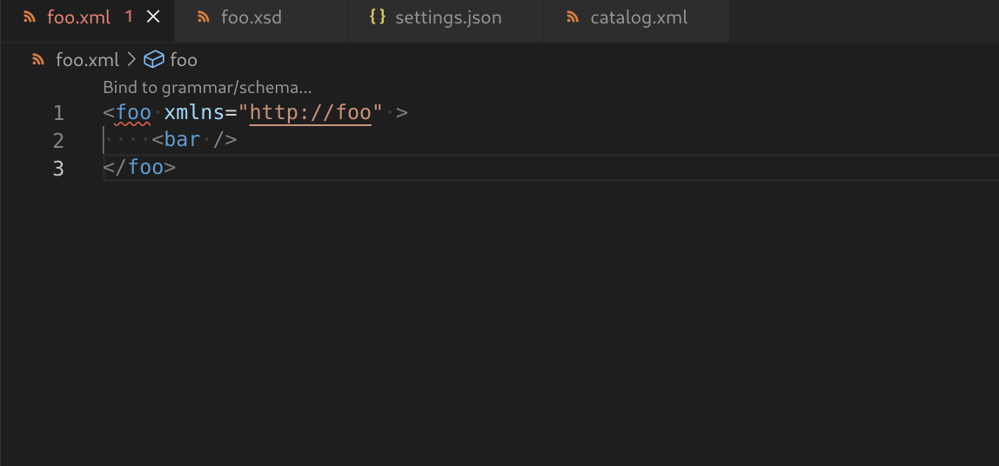

# XML Catalog Features

## Binding with Catalog

The [Binding Wizard](../BindingWithGrammar.md#catalog-entry) supports binding an XML document to a grammar through an XML Catalog entry. You can pick an existing catalog entry or add a new one directly from the wizard.

## Validation

XML Catalog is supported with both DTD and XSD. Please see here for more information on the usage of [XML Catalog With DTD](../Validation.md#xml-catalog-with-dtd) and [XML Catalog With XSD](../Validation.md#xml-catalog-with-xsd).

## Code Lens

### Register / Unregister Catalog

CodeLens is supported for XML catalogs, which shows whether the catalog is registered or not.
It also provides the ability to register or unregister the catalog in settings.json.



### References on Catalog Entries

When the [Workspace Index](../WorkspaceIndex.md) is enabled (`"xml.workspaceIndex.enabled": true`) **and** code lens is enabled (`"xml.codeLens.enabled": true`), each `<uri>`, `<system>`, and `<public>` entry in a registered catalog shows a **"N references"** code lens indicating how many XML files in the workspace use that catalog mapping.

The count is based on the catalog **identifier** — the namespace URI, system ID, or public ID — not the grammar filename. This means:
- `<uri name="http://example.org/ns" uri="schema.xsd"/>` → counts XML files using `xmlns="http://example.org/ns"` or `<?xml-model href="http://example.org/ns">`
- `<system systemId="http://example.org/schema" uri="schema.xsd"/>` → counts XML files using `SYSTEM "http://example.org/schema"`
- `<public publicId="-//Example//DTD//EN" uri="schema.dtd"/>` → counts XML files using `PUBLIC "-//Example//DTD//EN"`

<!-- TODO: screenshot CodeLensCatalogEntryReferences.png -->

Click the code lens to open the References panel listing every XML file that uses the catalog mapping, with the exact line of the reference.

> **Note:** The code lens is only shown for catalogs that are registered in `xml.catalogs`. An unregistered catalog is not used by LemMinX so its entries never produce cross-file references. Direct references to the grammar file by filename (e.g. `xsi:noNamespaceSchemaLocation="schema.xsd"`) are not counted because they bypass the catalog mapping.

## Unregistered Catalog Diagnostic

When you open an XML catalog file that is **not** listed in `xml.catalogs` settings, the `<catalog>` root element is highlighted as unused:

<!-- TODO: screenshot DiagnosticsUnregisteredCatalog.png -->

The diagnostic appears on the `<catalog>` element name and renders as:
- **Faded/greyed out** (Hint + `Unnecessary` tag) when the editor supports it
- **Warning** otherwise

The message reads: `This XML catalog is not registered in 'xml.catalogs'. It will not be used for grammar resolution.`

To fix it, add the catalog path to your settings:
```json
"xml.catalogs": [
  "/path/to/catalog.xml"
]
```

Or use the **Register Catalog** code lens that appears at the top of the file (see [Code Lens — Register / Unregister Catalog](#register--unregister-catalog) above).

## Unused Catalog Entry Diagnostics

When the [Workspace Index](../WorkspaceIndex.md) is enabled and the initial workspace scan has completed, catalog entries that are never used by any XML file in the workspace are reported as unused.

<!-- TODO: screenshot DiagnosticsCatalogUnusedEntry.png -->

The diagnostic appears on the entire entry element (e.g. `<uri name="http://foo" uri="schema.xsd"/>`) and renders as:
- **Faded/greyed out** (Hint + `Unnecessary` tag) when the editor supports it — identical to unused imports in other languages
- **Warning** otherwise

The message reads: `Catalog entry 'http://foo' is never used by any XML file in the workspace.`

The identifier shown in the message is the catalog key (`name`, `systemId`, or `publicId`) — the value that XML files would use to bind to the grammar.

**When this check runs:**
- Only after the workspace scan completes (to avoid false positives for not-yet-indexed files)
- Only for catalogs registered in `xml.catalogs`
- Only for `<uri>`, `<system>`, and `<public>` entries pointing to local grammar files
