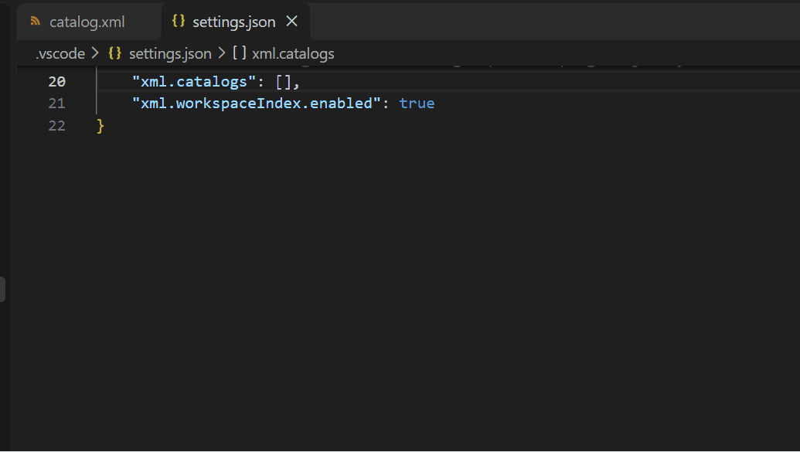
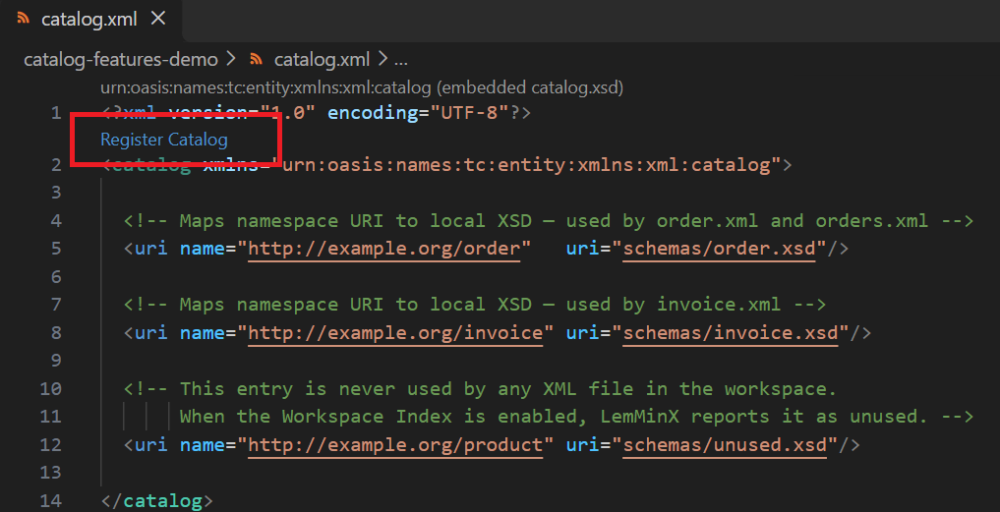
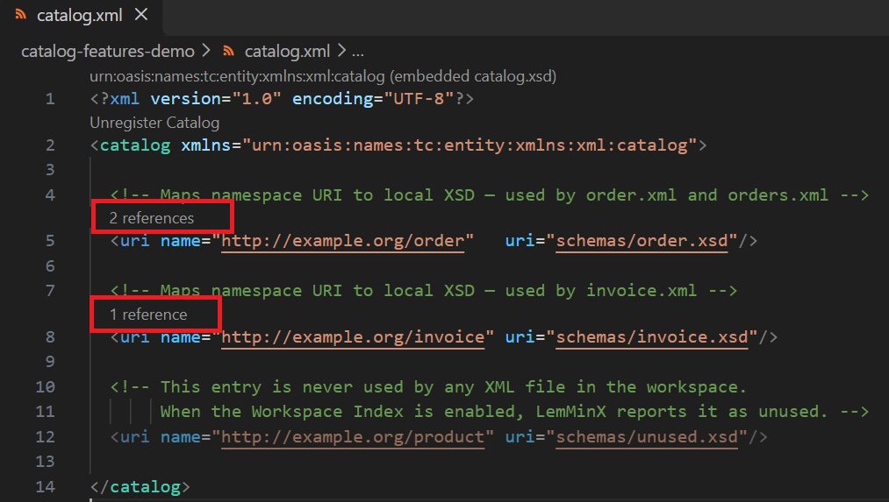
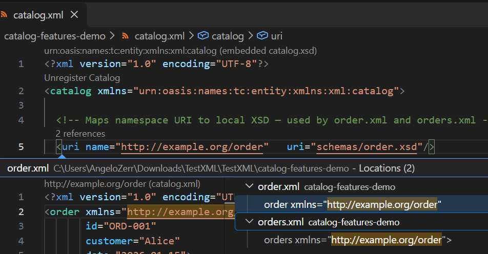
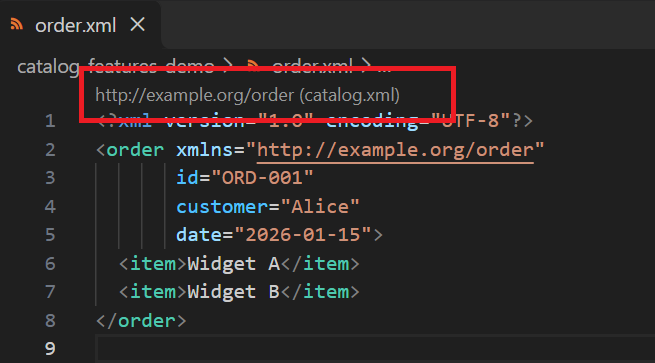
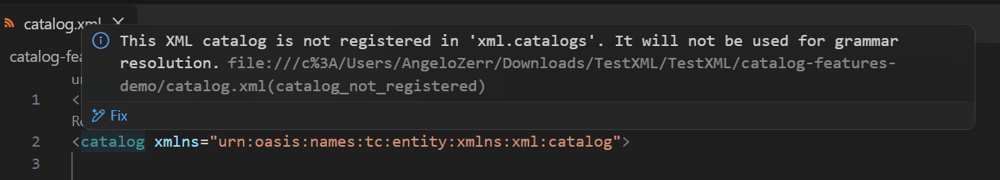
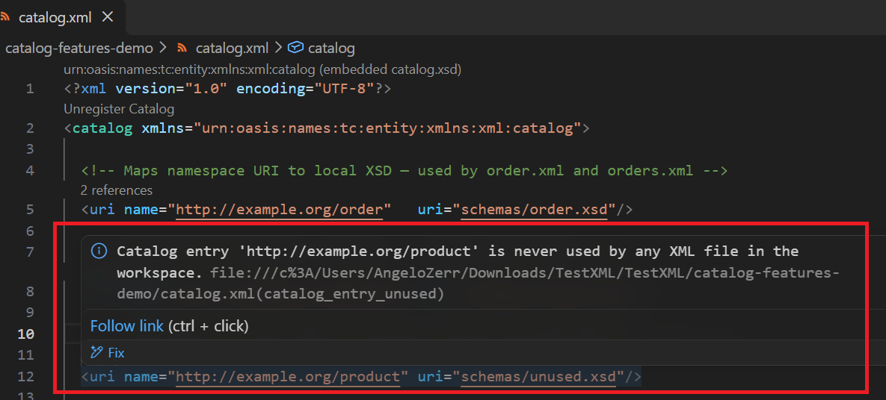
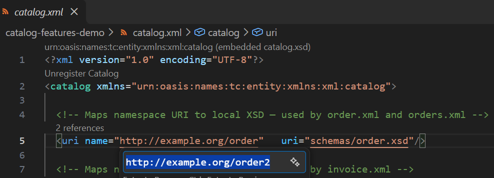
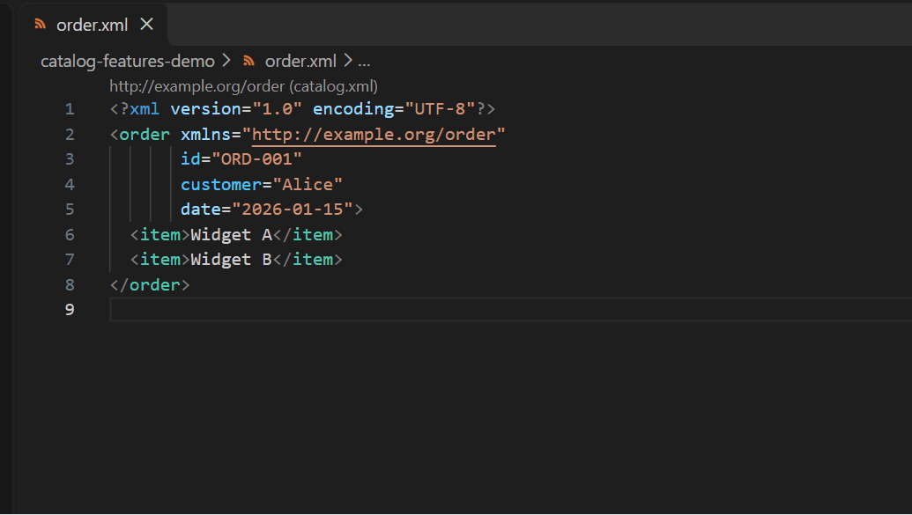
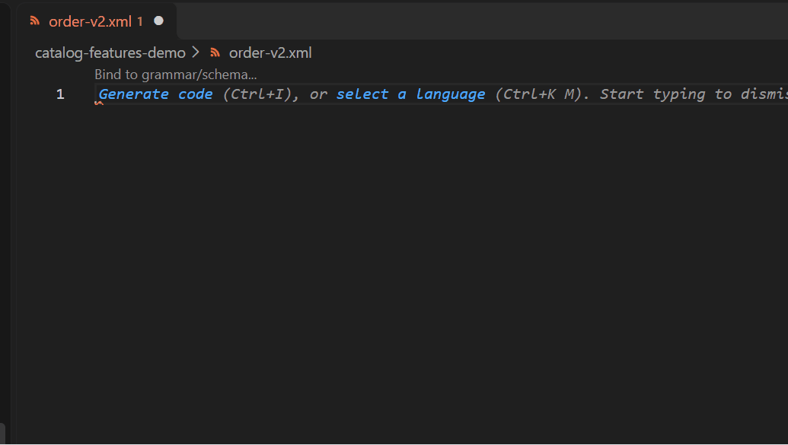

# XML Catalog Features

## Demo Workspace

All the examples in this page are based on the following workspace. Create these files to follow along.

**`catalog.xml`** — registers three namespaces:

```xml
<?xml version="1.0" encoding="UTF-8"?>
<catalog xmlns="urn:oasis:names:tc:entity:xmlns:xml:catalog">
  <uri name="http://example.org/order"   uri="schemas/order.xsd"/>
  <uri name="http://example.org/invoice" uri="schemas/invoice.xsd"/>
  <uri name="http://example.org/product" uri="schemas/product.xsd"/>
</catalog>
```

**`schemas/order.xsd`**:

```xml
<?xml version="1.0" encoding="UTF-8"?>
<xs:schema xmlns:xs="http://www.w3.org/2001/XMLSchema"
           targetNamespace="http://example.org/order"
           xmlns="http://example.org/order"
           elementFormDefault="qualified">
  <xs:element name="order">
    <xs:complexType>
      <xs:sequence>
        <xs:element name="item" type="xs:string" maxOccurs="unbounded"/>
      </xs:sequence>
      <xs:attribute name="id" type="xs:string" use="required"/>
    </xs:complexType>
  </xs:element>
</xs:schema>
```

**`schemas/invoice.xsd`**:

```xml
<?xml version="1.0" encoding="UTF-8"?>
<xs:schema xmlns:xs="http://www.w3.org/2001/XMLSchema"
           targetNamespace="http://example.org/invoice"
           xmlns="http://example.org/invoice"
           elementFormDefault="qualified">
  <xs:element name="invoice">
    <xs:complexType>
      <xs:sequence>
        <xs:element name="amount" type="xs:decimal"/>
      </xs:sequence>
      <xs:attribute name="id" type="xs:string" use="required"/>
    </xs:complexType>
  </xs:element>
</xs:schema>
```

**`schemas/product.xsd`**:

```xml
<?xml version="1.0" encoding="UTF-8"?>
<xs:schema xmlns:xs="http://www.w3.org/2001/XMLSchema"
           targetNamespace="http://example.org/product"
           xmlns="http://example.org/product"
           elementFormDefault="qualified">
  <xs:element name="product">
    <xs:complexType>
      <xs:attribute name="id" type="xs:string" use="required"/>
      <xs:attribute name="name" type="xs:string" use="required"/>
    </xs:complexType>
  </xs:element>
</xs:schema>
```

**`order.xml`** (uses `http://example.org/order`):

```xml
<?xml version="1.0" encoding="UTF-8"?>
<order xmlns="http://example.org/order" id="O-001">
  <item>Widget A</item>
</order>
```

**`orders.xml`** (also uses `http://example.org/order`):

```xml
<?xml version="1.0" encoding="UTF-8"?>
<order xmlns="http://example.org/order" id="O-002">
  <item>Widget B</item>
</order>
```

**`invoice.xml`** (uses `http://example.org/invoice`):

```xml
<?xml version="1.0" encoding="UTF-8"?>
<invoice xmlns="http://example.org/invoice" id="I-001">
  <amount>42.00</amount>
</invoice>
```

> No XML file uses `http://example.org/product` — this entry is intentionally unused to demonstrate the [Unused Catalog Entry Diagnostic](#unused-catalog-entry-diagnostics).

**`.vscode/settings.json`**:

```json
{
  "xml.workspaceIndex.enabled": true,
  "xml.codeLens.enabled": true
}
```

Once the workspace is open, open `catalog.xml` and click the **Register Catalog** code lens to register it in `xml.catalogs`. This is the starting point for all the features below.

## Features at a Glance



The sections below cover each feature individually.

## Validation

XML Catalog is supported with DTD, XSD, and RelaxNG (`.rng` / `.rnc`). Please see here for more information on the usage of [XML Catalog With DTD](../Validation.md#xml-catalog-with-dtd) and [XML Catalog With XSD](../Validation.md#xml-catalog-with-xsd).

For RelaxNG, catalog entries resolve the grammar referenced by the `xmlns` namespace URI or the `<?xml-model?>` href:

```xml
<!-- catalog.xml -->
<uri name="http://www.tei-c.org/ns/1.0" uri="schemas/tei_all.rng"/>
```

```xml
<!-- document.xml — namespace resolved via catalog -->
<TEI xmlns="http://www.tei-c.org/ns/1.0">
```

## Code Lens

### Register / Unregister Catalog

CodeLens is supported for XML catalogs, which shows whether the catalog is registered or not.
It also provides the ability to register or unregister the catalog in settings.json.



### References on Catalog Entries

When the [Workspace Index](../WorkspaceIndex.md) is enabled (`"xml.workspaceIndex.enabled": true`) **and** code lens is enabled (`"xml.codeLens.enabled": true`), each `<uri>`, `<system>`, `<namespace>`, and `<public>` entry in a registered catalog shows a **"N references"** code lens indicating how many XML files in the workspace use that catalog mapping.

The count is based on the catalog **identifier** — the namespace URI, system ID, or public ID — not the grammar filename.



Using the [demo workspace](#demo-workspace), `catalog.xml` shows:
- **"2 references"** on `<uri name="http://example.org/order" .../>` (`order.xml` + `orders.xml`)
- **"1 reference"** on `<uri name="http://example.org/invoice" .../>` (`invoice.xml`)
- **"0 references"** on `<uri name="http://example.org/product" .../>` (unused — faded)

Click the code lens to open the References panel listing every XML file that uses the catalog mapping, with the exact line of the reference.



> **Note:** The code lens is only shown for catalogs that are registered in `xml.catalogs`. An unregistered catalog is not used by LemMinX so its entries never produce cross-file references. Direct references to the grammar file by filename (e.g. `xsi:noNamespaceSchemaLocation="schema.xsd"`) are not counted because they bypass the catalog mapping.

### Grammar Bound via Catalog

When an XML file is bound to a grammar through a catalog entry, the referenced-grammar code lens (shown at the top of the file) includes the **catalog filename** :



Using the [demo workspace](#demo-workspace), opening `order.xml` shows the following code lens at the top of the file:

```
http://example.org/order (xsi:schemaLocation with catalog.xml)
```

Clicking the code lens opens the grammar file. The catalog filename makes it easy to identify which catalog is responsible for the binding when several catalogs are registered.

## Unregistered Catalog Diagnostic

When you open an XML catalog file that is **not** listed in `xml.catalogs` settings, the `<catalog>` root element is highlighted as unused.



The diagnostic appears on the `<catalog>` element name and renders as:
- **Faded/greyed out** (Hint + `Unnecessary` tag) when the editor supports it
- **Warning** otherwise

The message reads: `This XML catalog is not registered in 'xml.catalogs'. It will not be used for grammar resolution.`

To reproduce with the [demo workspace](#demo-workspace), temporarily remove the catalog from your settings:

```json
"xml.catalogs": []
```

The `<catalog>` element name immediately shows the warning.

To fix it, add the catalog path back to your settings:

```json
"xml.catalogs": [
  "${workspaceFolder}/catalog.xml"
]
```

Or use the **Register Catalog** code lens that appears at the top of the file (see [Register / Unregister Catalog](#register--unregister-catalog) above).

## Unused Catalog Entry Diagnostics

When the [Workspace Index](../WorkspaceIndex.md) is enabled and the initial workspace scan has completed, catalog entries that are never used by any XML file in the workspace are reported as unused.



The diagnostic appears on the entire entry element and renders as:
- **Faded/greyed out** (Hint + `Unnecessary` tag) when the editor supports it — identical to unused imports in other languages
- **Warning** otherwise

The message reads: `Catalog entry 'http://example.org/product' is never used by any XML file in the workspace.`

The identifier shown in the message is the catalog key (`name`, `systemId`, or `publicId`) — the value that XML files would use to bind to the grammar.

Using the [demo workspace](#demo-workspace), the entry `<uri name="http://example.org/product" uri="schemas/product.xsd"/>` has no XML file referencing `xmlns="http://example.org/product"`. Once the workspace scan completes (a few seconds after opening), this entry is highlighted as unused.

**When this check runs:**
- Only after the workspace scan completes (to avoid false positives for not-yet-indexed files)
- Only for catalogs registered in `xml.catalogs`
- Only for `<uri>`, `<system>`, `<namespace>`, and `<public>` entries pointing to local grammar files

## Rename Catalog Identifier

When the [Workspace Index](../WorkspaceIndex.md) is enabled, you can rename a catalog identifier — the `name` attribute of a `<uri>` or `<namespace>` entry, the `systemId` of a `<system>` entry, or the `publicId` of a `<public>` entry — and all workspace XML files that use that identifier are updated automatically.

**How to trigger:** Place the cursor inside the identifier attribute value and press `F2` (or right-click → Rename Symbol).



Using the [demo workspace](#demo-workspace), renaming `http://example.org/order` to `http://mycompany.org/order` in `catalog.xml`:

```xml
<!-- catalog.xml — before -->
<uri name="http://example.org/order" uri="schemas/order.xsd"/>

<!-- catalog.xml — after -->
<uri name="http://mycompany.org/order" uri="schemas/order.xsd"/>
```

Automatically updates all XML files that declared the old namespace:

```xml
<!-- order.xml — before -->
<order xmlns="http://example.org/order">

<!-- order.xml — after -->
<order xmlns="http://mycompany.org/order">
```

**What is renamed:**
- The catalog entry attribute value itself (`name`, `systemId`, or `publicId`)
- All `xmlns=`, `xmlns:prefix=`, `DOCTYPE SYSTEM`, `DOCTYPE PUBLIC`, and `<?xml-model href=>` occurrences of the same identifier in workspace XML files

**What is NOT renamed:**
- The `uri` attribute (the grammar file path) — rename the grammar file separately
- Grammar-to-grammar references (XSD `xs:import`, etc.)

## Go to Catalog Entry (Type Definition)

When you trigger **Go to Type Definition** (`F12` or right-click → Go to Type Definition) on an XML element, vscode-xml navigates to the catalog entry that binds the element's namespace URI, in addition to the XSD type definition.

The cursor lands on the **identifier attribute value** (e.g. the `name` attribute of a `<namespace>` or `<uri>` entry), making it easy to see which catalog mapping is responsible for the grammar binding.



Using the [demo workspace](#demo-workspace), pressing `F12` on the `<order>` element in `order.xml`:

```xml
<!-- order.xml — press F12 on <order> -->
<order xmlns="http://example.org/order" id="O-001">
```

navigates to `catalog.xml` with the cursor on the identifier value:

```xml
<uri name="http://example.org/order" uri="schemas/order.xsd"/>
<!--       ^^^^^^^^^^^^^^^^^^^^^^^^^^^^ cursor lands here -->
```

**When a result is returned:**
- The element (or the element owning the cursor's attribute) has a non-empty `xmlns` namespace URI
- At least one registered catalog contains a matching `<namespace>` or `<uri>` entry for that URI

**When no result is returned:**
- The element has no namespace URI (no `xmlns`)
- No registered catalog maps the namespace URI

## Binding with Catalog

The [Binding Wizard](../BindingWithGrammar.md#catalog-entry) supports binding an XML document to a grammar through an XML Catalog entry. You can pick an existing catalog entry or add a new one directly from the wizard.


