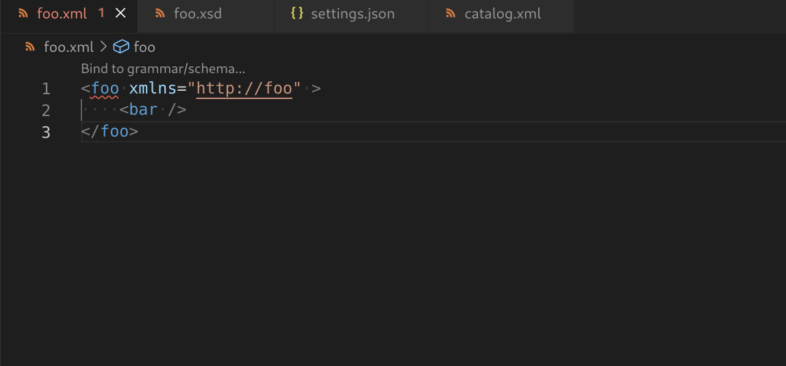

# XML Catalog Features

## Binding with Catalog

The [Binding Wizard](../BindingWithGrammar.md#catalog-entry) supports binding an XML document to a grammar through an XML Catalog entry. You can pick an existing catalog entry or add a new one directly from the wizard.

## Validation

XML Catalog is supported with both DTD and XSD. Please see here for more information on the usage of [XML Catalog With DTD](../Validation.md#xml-catalog-with-dtd) and [XML Catalog With XSD](../Validation.md#xml-catalog-with-xsd).

## Code Lens

CodeLens is supported for XML catalogs, which shows whether the catalog is registered or not.
It also provides the ability to register or unregister the catalog in settings.json.

