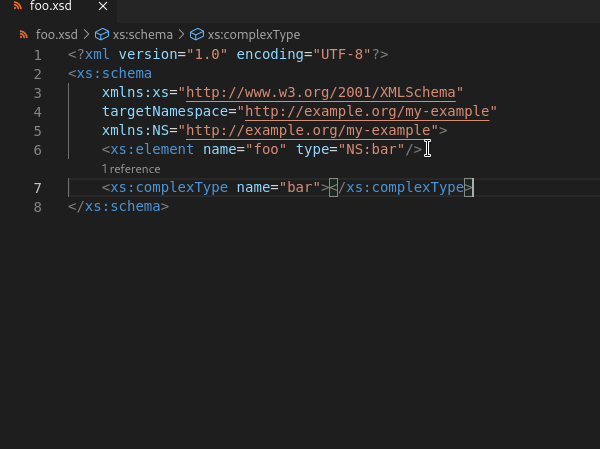
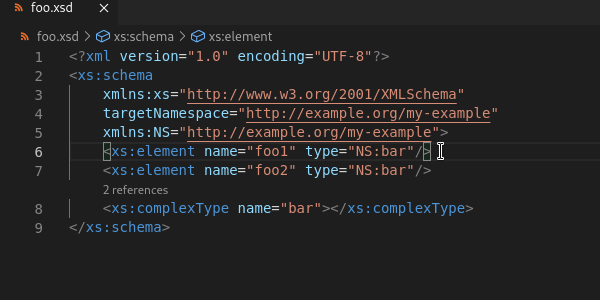
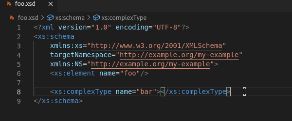
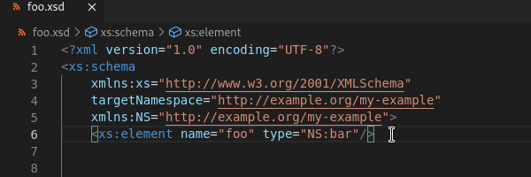
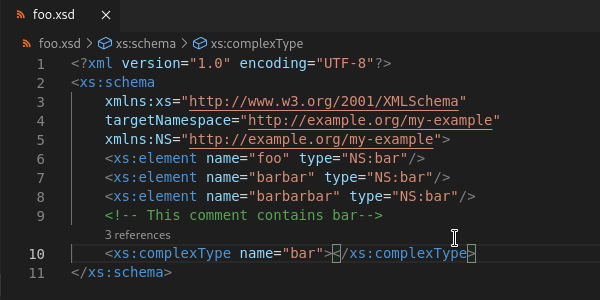
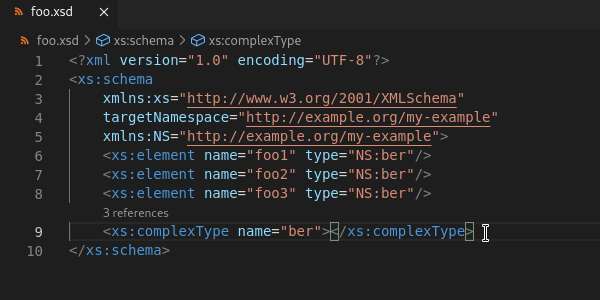
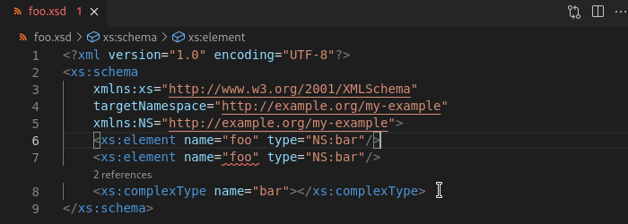
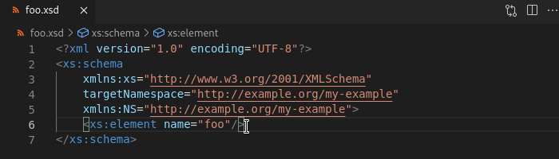

# XSD Features

## Binding

See [Binding with Grammar](../BindingWithGrammar.md#xsd-binding) to associate an XML file with an XSD using the binding wizard.

## CodeLens Support

CodeLens is supported for `.xsd` files, which can show where a type is referenced.

This feature also supports listing the number of references to a type and the line(s) referenced on.

### Read more

See [CodeLens](../CodeLens.md#code-lens) for more details.

## XSD Tag Support

After defining a `Type` or `element` tag in the `.xsd` file, there are a number of features supported in relation to types/elements.

### Type completion

There is autocompletion support for assigning these types to element tags.

### Jump to type definition

For an `element` tag that is assigned a type, there is support for navigating to its definition from any type assignment.

### Highlight type instances

After defining a `Type` or `element`, selecting the `name` attribute will highlight all occurrences.

### Change all type occurrences

To rename a `Type` definition and its associated `element` `type` attribute values, highlight the `name` attribute of the `Type` and press `F2` or use the dropdown to select `Rename Symbol`.

## Workspace Index

When [Workspace Index](../WorkspaceIndex.md) is enabled (`"xml.workspaceIndex.enabled": true`), XSD grammar files gain two additional cross-file features.

### Code lens — N references

A **"N references"** code lens appears above the root element of the `.xsd` file, showing how many XML files in the workspace reference it. Click it (or use **Find All References**) to open the References panel with the exact location of each reference.

> **Prerequisite:** Code lens must also be enabled — set `"xml.codeLens.enabled": true`.

<!-- TODO: add screenshot here (WorkspaceIndexCodeLensXSD.png) -->

### Rename grammar file

Renaming an `.xsd` file in the VS Code Explorer automatically updates all XML files that reference it (via `xsi:noNamespaceSchemaLocation`, `xsi:schemaLocation`, or `<?xml-model?>`).

See [Workspace Index](../WorkspaceIndex.md) for full setup and details.

## Syntax Validation

XSD syntax validation is enabled for any `.xsd` file.

### Validate element name with same type

Validation of `.xsd` files enforces all `element` tags that share a type to have different names.

### Validate type definition exists

Validation of `.xsd` files enforces all `element` tags to be assigned a type that has already been defined.

