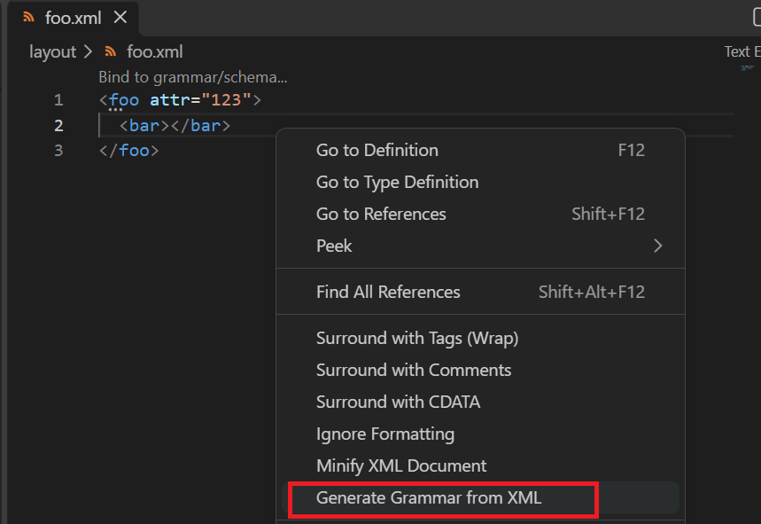
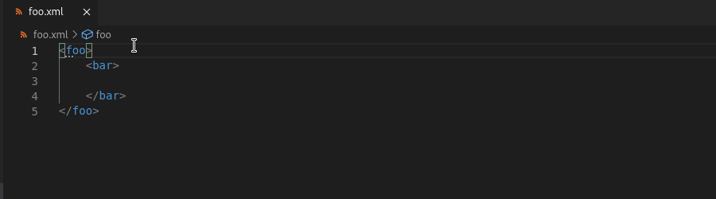
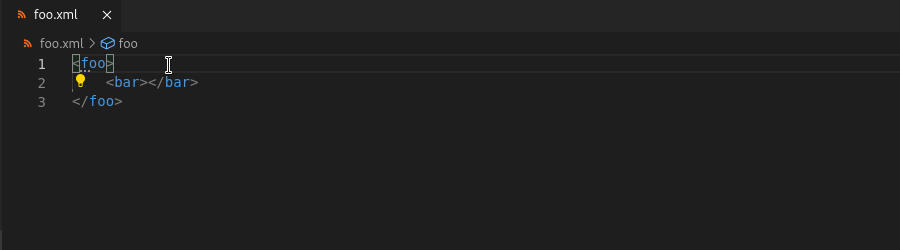
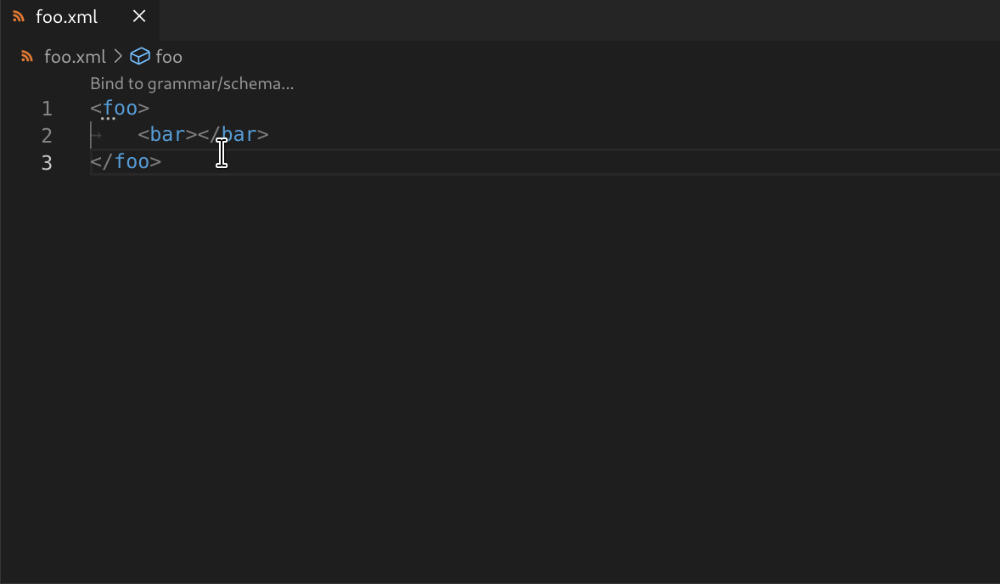

# Generate Grammar from XML

[vscode-xml](https://github.com/redhat-developer/vscode-xml) can generate a grammar file (XSD, DTD, RelaxNG, or RNC) from an existing XML document, and automatically bind the XML to the generated grammar.

> **Tip:** Generation also works in the other direction: you can [generate an XML document from a grammar](GenerateXMLFromGrammar.md).

## How to use

### From the Command Palette

Open the command palette with `Ctrl+Shift+P` and run:

**XML: Generate Grammar from XML**

This command is only available when the XML document is **not already bound** to a grammar.

### From the Context Menu

Right-click on an XML file in the **Explorer** or in the **Editor** and select **Generate Grammar from XML**.

This entry is only visible in the editor context menu when the XML document has no grammar bound.



### From a Quick Fix

When an XML document has no grammar bound, a diagnostic appears on the root element. Click the lightbulb or press `Ctrl + .` to see Quick Fix options such as *"Generate foo.xsd and bind with xsi:noNamespaceSchemaLocation"* or *"Generate foo.dtd and bind with DOCTYPE"*.

See [Quick Fix](#quick-fix) for screenshots.

## Wizard Steps

The wizard guides you through the following steps:

1. **Select grammar type**: XSD, DTD, RelaxNG (.rng), or RelaxNG Compact (.rnc)
2. **Select binding type**: depends on the grammar type (see [Binding types](#binding-types))
3. **Enter grammar file name**: defaults to the XML file name with the grammar extension (e.g., `foo.xsd`)

The grammar file is generated in the same directory as the XML document, and the selected binding is automatically inserted into the XML file.

### Binding types

The available binding types depend on the selected grammar type:

| Grammar type | Binding types |
|-------------|---------------|
| XSD | `xsi:schemaLocation`, `xml-model`, File association |
| DTD | `DOCTYPE`, `xml-model`, File association |
| RelaxNG | `xml-model`, File association |
| RelaxNG Compact | `xml-model`, File association |

See [Binding with Grammar](BindingWithGrammar.md) for details on each binding type.

## Examples

### Generate XSD from XML

Given `foo.xml`:

```xml
<foo>
  <bar />
</foo>
```

Choosing XSD with `xsi:schemaLocation` binding generates `foo.xsd`. The binding type is automatically resolved: `xsi:noNamespaceSchemaLocation` when the XML has no namespace, or `xsi:schemaLocation` when it has one.

For example, with no namespace, it generates `foo.xsd`:

```xml
<?xml version="1.0" encoding="UTF-8"?>
<xs:schema xmlns:xs="http://www.w3.org/2001/XMLSchema">
  <xs:element name="foo">
    <xs:complexType>
      <xs:sequence>
        <xs:element name="bar" />
      </xs:sequence>
    </xs:complexType>
  </xs:element>
</xs:schema>
```

And updates `foo.xml` with the binding:

```xml
<foo xmlns:xsi="http://www.w3.org/2001/XMLSchema-instance"
    xsi:noNamespaceSchemaLocation="foo.xsd">
  <bar />
</foo>
```

### Generate DTD from XML

Choosing DTD with `DOCTYPE` generates `foo.dtd`:

```dtd
<!ELEMENT foo (bar)>
<!ELEMENT bar EMPTY>
```

And updates `foo.xml`:

```xml
<!DOCTYPE foo SYSTEM "foo.dtd">
<foo>
  <bar />
</foo>
```

### Generate RelaxNG from XML

Choosing RelaxNG with `xml-model` generates `foo.rng`:

```xml
<?xml version="1.0" encoding="UTF-8"?>
<grammar xmlns="http://relaxng.org/ns/structure/1.0"
  datatypeLibrary="http://www.w3.org/2001/XMLSchema-datatypes">
  <start>
    <ref name="fooContent" />
  </start>
  <define name="fooContent">
    <element name="foo">
      <ref name="barContent" />
    </element>
  </define>
  <define name="barContent">
    <element name="bar">
      <empty />
    </element>
  </define>
</grammar>
```

And updates `foo.xml`:

```xml
<?xml-model href="foo.rng"?>
<foo>
  <bar />
</foo>
```

### Generate RelaxNG Compact from XML

Choosing RelaxNG Compact with `xml-model` generates `foo.rnc`:

```rnc
datatypes xsd = "http://www.w3.org/2001/XMLSchema-datatypes"

start = fooContent
fooContent = element foo { barContent }
barContent = element bar { empty }
```

And updates `foo.xml`:

```xml
<?xml-model href="foo.rnc"?>
<foo>
  <bar />
</foo>
```

## Quick Fix

Grammar generation is also available as a Quick Fix on unbound XML documents.

With the cursor on the root element, use `Ctrl + .` or `Quick Fix...` or the lightbulb that appears and select "Generate foo.xsd and bind with ..." (or dtd, rng, rnc).

Generate an XSD and bind with `xsi:schemaLocation`:



Generate a DTD and bind with `DOCTYPE`:



Generate a RelaxNG schema and bind with `xml-model`:


