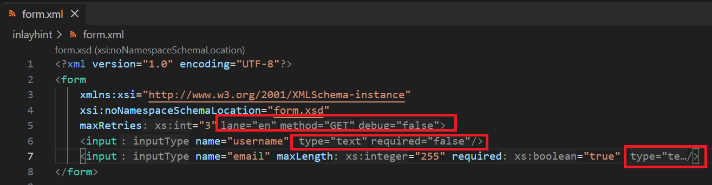
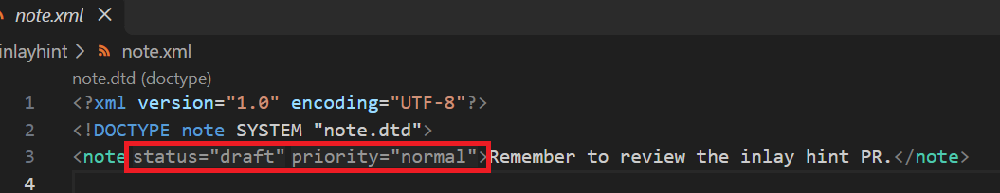
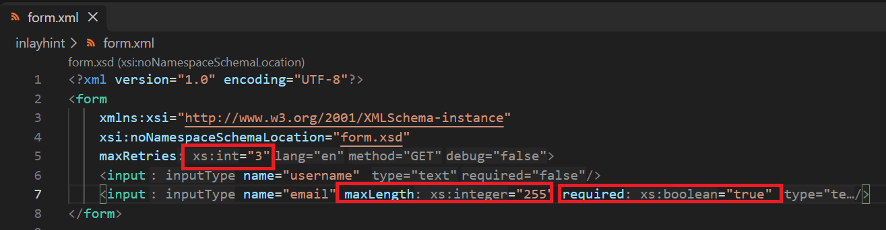
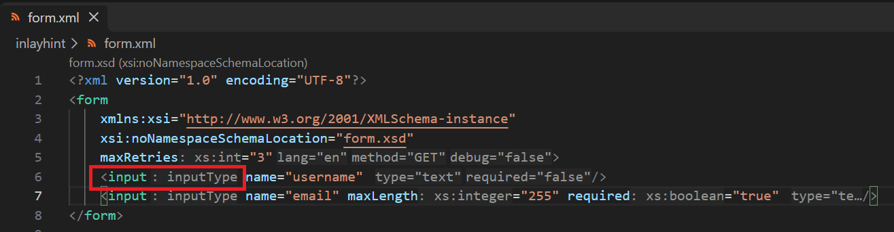

## Inlay Hint

Inlay hints display grammar-derived information directly in the editor to help you understand the structure of your XML documents without having to look at the schema.

To enable inlay hints, set `xml.inlayHint.enabled` to `true` (default is `false`).

There are three kinds of inlay hints, each controlled by its own setting:

| Setting | Default | Description |
|---------|---------|-------------|
| `xml.inlayHint.enabled` | `false` | Enable/disable XML inlay hints |
| `xml.inlayHint.showDefaultValue` | `true` | Show default attribute values from the grammar |
| `xml.inlayHint.showAttributeType` | `true` | Show attribute types (e.g., `: xs:integer`) |
| `xml.inlayHint.showElementType` | `true` | Show element types (e.g., `: xs:boolean`) |

Types equal to `xs:string` are automatically filtered out as they are too common to be informative.

### Default attribute values

When an XML file is bound to a grammar (XSD, DTD) that defines `default` or `fixed` attribute values, inlay hints show these values next to the element's start tag for attributes that are not explicitly set.

For example, given the following XSD (`form.xsd`):

```xml
<?xml version="1.0" encoding="UTF-8"?>
<xs:schema xmlns:xs="http://www.w3.org/2001/XMLSchema">
    <xs:element name="form">
        <xs:complexType>
            <xs:sequence>
                <xs:element name="input" type="inputType" maxOccurs="unbounded" />
            </xs:sequence>
            <xs:attribute name="lang" type="xs:string" default="en" />
            <xs:attribute name="method" type="xs:string" default="GET" />
            <xs:attribute name="maxRetries" type="xs:int" />
            <xs:attribute name="debug" type="xs:boolean" default="false" />
        </xs:complexType>
    </xs:element>
    <xs:complexType name="inputType">
        <xs:attribute name="name" type="xs:string" />
        <xs:attribute name="type" type="xs:string" default="text" />
        <xs:attribute name="maxLength" type="xs:integer" />
        <xs:attribute name="required" type="xs:boolean" default="false" />
    </xs:complexType>
</xs:schema>
```

And the following XML (`form.xml`):

```xml
<?xml version="1.0" encoding="UTF-8"?>
<form
    xmlns:xsi="http://www.w3.org/2001/XMLSchema-instance"
    xsi:noNamespaceSchemaLocation="form.xsd"
    maxRetries="3">
    <input name="username" />
    <input name="email" maxLength="255" required="true" />
</form>
```

Inlay hints for default attribute values will appear:

- On `<form>`: `lang="en"`, `method="GET"`, `debug="false"`
- On `<input name="username" />`: `type="text"`, `required="false"`
- On `<input name="email" ...>`: `type="text"` (but not `required` since it is explicitly set)



Default attribute values defined in DTD `ATTLIST` declarations are also shown.

Given the following DTD (`note.dtd`):

```dtd
<!ELEMENT note (#PCDATA)>
<!ATTLIST note
    status CDATA "draft"
    priority CDATA "normal">
```

And the following XML (`note.xml`):

```xml
<?xml version="1.0" encoding="UTF-8"?>
<!DOCTYPE note SYSTEM "note.dtd">
<note>Remember to review the inlay hint PR.</note>
```

Inlay hints `status="draft"` and `priority="normal"` will appear after the `note` tag name.



### Attribute types

When enabled, attribute type hints show the XSD type of each attribute after the attribute name (before the `=` sign).

Using the same `form.xsd` and `form.xml` above, the following attribute type hints are shown:

- `maxRetries` → `: xs:int`
- `maxLength` → `: xs:integer`
- `required` → `: xs:boolean`
- `lang`, `method`, `name`, `type` → no type hint (`xs:string` is filtered out)



### Element types

When enabled, element type hints show the XSD type of each element after the element tag name.

Using the same `form.xsd` and `form.xml` above, the following element type hints are shown:

- `<input>` → `: inputType`
- `<form>` → no type hint (anonymous complex type, no named type)



Elements with anonymous (inline) complex types do not show a type hint, since they have no named type.

### Settings

- `xml.inlayHint.enabled`: Enable/disable XML inlay hints. Default is `false`.
- `xml.inlayHint.showDefaultValue`: Show default attribute values from grammar. Default is `true`.
- `xml.inlayHint.showAttributeType`: Show attribute types. Default is `true`.
- `xml.inlayHint.showElementType`: Show element types. Default is `true`.
