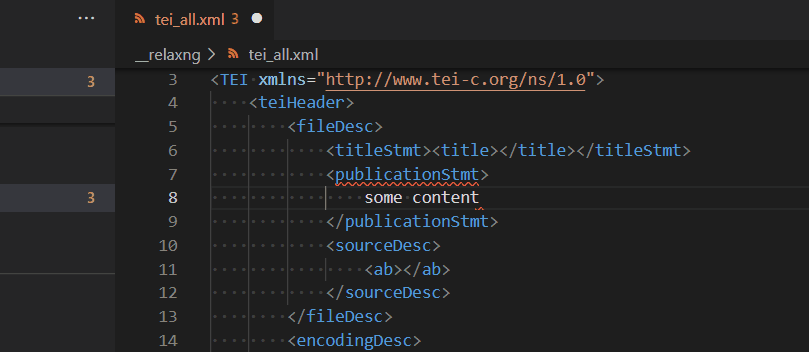
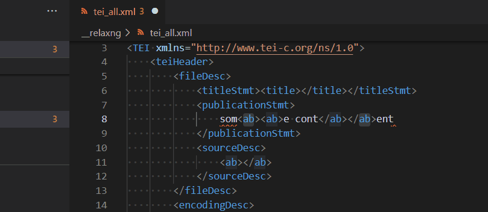
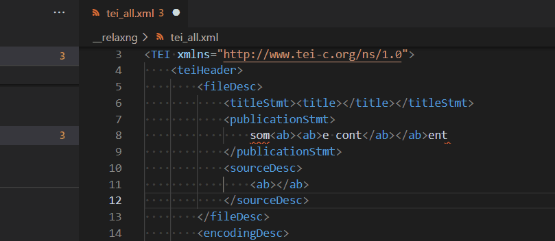
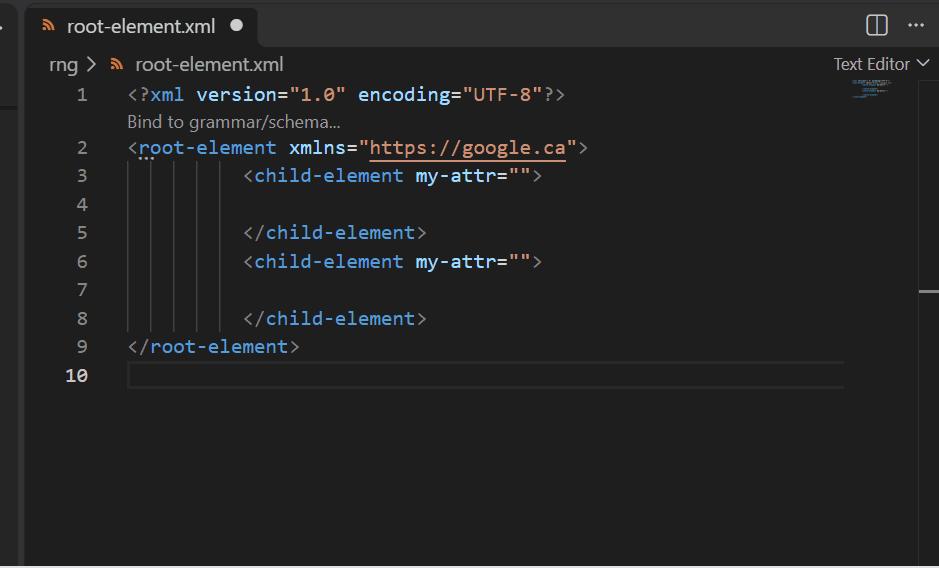

# Refactor

[vscode-xml](https://github.com/redhat-developer/vscode-xml) provides several refactoring commands to wrap selected XML content. All Surround with commands are available from:

- **Command palette** (`Ctrl+Shift+P`): type `Surround`
- **Editor context menu**: right-click on an XML file

If you prefer using the keyboard, you can associate each command with a keybinding. See [Keyboard Shortcuts editor](https://code.visualstudio.com/docs/getstarted/keybindings#_keyboard-shortcuts-editor) for more information.

## Surround with Tags (Wrap)

Select XML content and surround it with a given tag:

## Surround with Comments

Comment out the selected XML content:

## Surround with CDATA

Surround the selected XML content with CDATA:

## Surround with Ignore Formatting

Surround the selected XML content with `<!-- @formatter:off -->` / `<!-- @formatter:on -->` markers to preserve formatting in that region.

