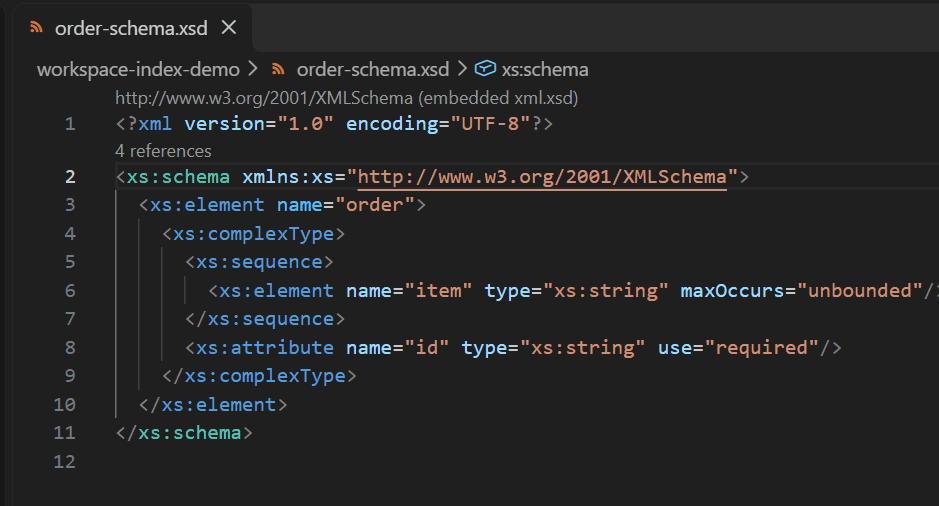
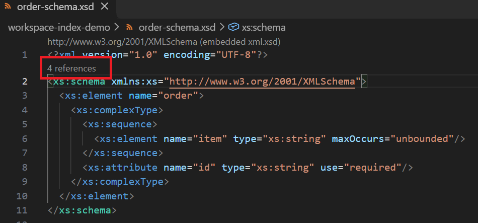
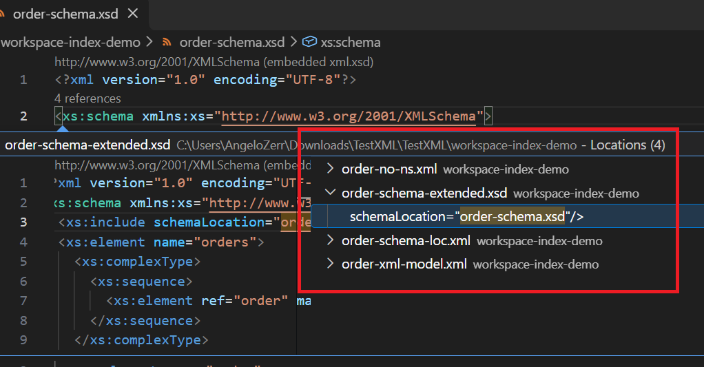
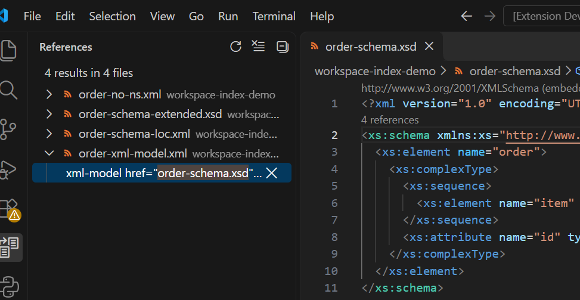
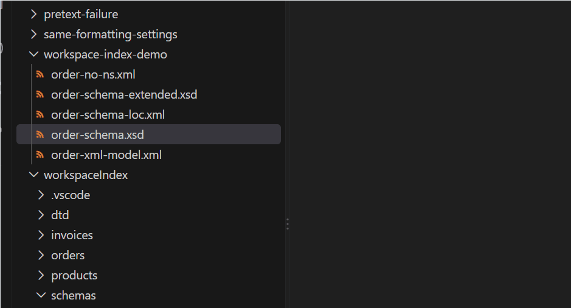

# Workspace Index

> **This feature is disabled by default.** Add the following to your VS Code settings to enable it:
> ```json
> "xml.workspaceIndex.enabled": true
> ```

When VS Code opens a workspace that contains grammar files (XSD, DTD, RNG, RNC, WSDL, XSL, XSLT) and the Workspace Index is disabled, a notification is shown automatically:

> *Your workspace contains grammar files (XSD, DTD, RNG, RNC…). Enable the Workspace Index to automatically update XML references when renaming these files. If you experience Out Of Memory errors, you can limit the scan via `xml.workspaceIndex.headLimits`.*

| Action | Effect |
|---|---|
| **Enable Globally** | Enables `xml.workspaceIndex.enabled` in your global user settings |
| **For this Workspace** | Enables `xml.workspaceIndex.enabled` only for the current workspace |
| **Learn more** | Opens this documentation page |
| **Don't show again** | Permanently suppresses the notification across all workspaces |
| *(dismiss ×)* | No action — the notification will appear again the next time VS Code is opened |

The workspace index is a Bloom-filter-based index that the XML language server builds at startup by scanning all XML-family files in the workspace. It enables cross-file grammar reference features without opening or parsing files at query time.

## Demo



Consider a workspace with one XSD grammar, a second XSD that extends it, and three XML files — all referencing `order-schema.xsd` in different ways:

**`order-schema.xsd`**
```xml
<?xml version="1.0" encoding="UTF-8"?>
<xs:schema xmlns:xs="http://www.w3.org/2001/XMLSchema">
  <xs:element name="order">
    <xs:complexType>
      <xs:sequence>
        <xs:element name="item" type="xs:string" maxOccurs="unbounded"/>
      </xs:sequence>
      <xs:attribute name="id" type="xs:string" use="required"/>
    </xs:complexType>
  </xs:element>
</xs:schema>
```

**`order-schema-extended.xsd`** — extends the base XSD via `xs:include`
```xml
<?xml version="1.0" encoding="UTF-8"?>
<xs:schema xmlns:xs="http://www.w3.org/2001/XMLSchema">
  <xs:include schemaLocation="order-schema.xsd"/>
  <xs:element name="orders">
    <xs:complexType>
      <xs:sequence>
        <xs:element ref="order" maxOccurs="unbounded"/>
      </xs:sequence>
    </xs:complexType>
  </xs:element>
</xs:schema>
```

**`order-xml-model.xml`** — references the XSD via `<?xml-model?>`
```xml
<?xml-model href="order-schema.xsd"?>
<order id="1">
  <item>Widget</item>
</order>
```

**`order-no-ns.xml`** — references the XSD via `xsi:noNamespaceSchemaLocation`
```xml
<?xml version="1.0"?>
<order id="2"
  xmlns:xsi="http://www.w3.org/2001/XMLSchema-instance"
  xsi:noNamespaceSchemaLocation="order-schema.xsd">
  <item>Gadget</item>
</order>
```

**`order-schema-loc.xml`** — references the XSD via `xsi:schemaLocation`
```xml
<?xml version="1.0"?>
<order id="3"
  xmlns="http://example.com"
  xmlns:xsi="http://www.w3.org/2001/XMLSchema-instance"
  xsi:schemaLocation="http://example.com order-schema.xsd">
  <item>Doohickey</item>
</order>
```

### Step 1 — Browse backlinks from the grammar file

Open `order-schema.xsd`. The root element shows a **"4 references"** code lens:



> **Prerequisite:** Code lens must also be enabled — set `"xml.codeLens.enabled": true`.

Click **"4 references"** to open the References panel. All four files are listed — including the XSD that includes this one:



You can also trigger **Find All References** (Shift+Alt+F12) with the cursor anywhere inside `order-schema.xsd` to get the same result.



### Step 2 — Rename the grammar file

In the VS Code Explorer, rename `order-schema.xsd` to `order-schema-v2.xsd`.

The workspace index intercepts the rename via `workspace/willRenameFiles` and automatically updates all four files **before** the file is renamed on disk:



**`order-schema-extended.xsd`** (updated)
```xml
  <xs:include schemaLocation="order-schema-v2.xsd"/>
```

**`order-xml-model.xml`** (updated)
```xml
<?xml-model href="order-schema-v2.xsd"?>
```

**`order-no-ns.xml`** (updated)
```xml
  xsi:noNamespaceSchemaLocation="order-schema-v2.xsd"
```

**`order-schema-loc.xml`** (updated)
```xml
  xsi:schemaLocation="http://example.com order-schema-v2.xsd"
```

Relative paths (e.g. `../schemas/order-schema.xsd`) are also resolved correctly — the new value preserves the original relative path structure adjusted to the new filename.

## Features powered by the index

| Feature | Description |
|---|---|
| **Find References on a grammar file** | Right-click a `.xsd`, `.dtd`, `.rng`, `.rnc`, `.xsl`, or `.wsdl` file → Find References — lists every XML file that references it |
| **Code lens "N references" on grammar files** | Grammar files show a clickable "N references" count above the root element (requires `xml.codeLens.enabled: true`) |
| **Rename grammar file** | Rename a grammar file in the Explorer — all XML files that reference it are updated automatically |
| **Code lens "N references" on catalog entries** | Each `<uri>`, `<system>`, and `<public>` entry in a registered catalog shows how many XML files use that catalog mapping (requires `xml.codeLens.enabled: true`) |
| **Unused catalog entry diagnostics** | Catalog entries that are never referenced by any XML file are highlighted as unused (greyed out in VS Code) |

## How it works

1. **At startup** — the server scans all XML-family files in the workspace folders asynchronously. For each file a [Bloom filter](https://en.wikipedia.org/wiki/Bloom_filter) is built from the grammar names it contains (extracted from `<?xml-model href="...">`, `xsi:schemaLocation`, `xsi:noNamespaceSchemaLocation`, `<!DOCTYPE ... SYSTEM "...">`, `xs:include`, XInclude `href`, etc.).

2. **At query time** — the index answers "which files might reference grammar X?" in O(n) time without opening any file. Candidate files are then read precisely to locate exact offsets.

3. **On file change** — the index stays up to date automatically:
   - Saving an XML file re-indexes it; if grammar references are found, the code lens count updates immediately.
   - Creating or copying an XML file triggers re-indexing via `workspace/didChangeWatchedFiles`.
   - Deleted files are removed from the index.

### Memory footprint

- Each Bloom filter is approximately 12 bytes per 100 entries. A workspace with 10,000 files uses roughly 12 KB total for the index.
- By default there are no per-file limits — the streaming scanner never loads the full file into memory, so Out Of Memory errors are not a concern. Configure `xml.workspaceIndex.headLimits` only to cap scan time on unusually large files.

## Settings

### `xml.workspaceIndex.enabled`

| | |
|---|---|
| **Type** | `boolean` |
| **Default** | `false` |

Enable or disable the workspace Bloom index. **Disabled by default** — must be explicitly enabled:

```json
"xml.workspaceIndex.enabled": true
```

When disabled:
- Find References on grammar files is not available
- Automatic reference updates on grammar file rename are not applied
- The code lens "N references" on grammar files is not shown

Useful in very large workspaces where scanning is undesirable, or when these features are not needed.

### `xml.workspaceIndex.excludeDirectories`

| | |
|---|---|
| **Type** | `string[]` |
| **Default** | `[".git", ".hg", ".svn", "node_modules", "target", "build", ".gradle", "out", "dist", "bin"]` |

Directory names to skip when building the workspace index at startup. Any directory whose **simple name** exactly matches an entry in this list — and all of its descendants — is excluded from the scan.

The defaults cover the most common generated-output and VCS directories. You can extend the list in your VS Code settings:

```json
"xml.workspaceIndex.excludeDirectories": [
  ".git", ".hg", ".svn",
  "node_modules",
  "target", "build",
  ".gradle",
  "out", "dist", "bin",
  "my-generated-folder"
]
```

> **Note:** Setting this to a custom list replaces the defaults entirely. To extend rather than replace, copy the defaults and add your entries.

Requires `xml.workspaceIndex.enabled: true`.

### `xml.workspaceIndex.headLimits`

| | |
|---|---|
| **Type** | `object` |
| **Default** | `{}` (no limits) |

Controls how many characters are read from each file during indexing. **By default there are no limits** — the index uses a streaming scanner that never loads the full file into memory, so Out Of Memory errors are not a concern. Configure limits only when you want to cap scan time on unusually large files.

**Keys are glob patterns** (e.g. `"**/*.xsd"`, `"**/vendor/**"`). The **longest matching pattern wins** — no need to worry about ordering. A file matched by no pattern is read in full (no limit).

#### Size string format

Values are human-readable size strings (case-insensitive):

| Format | Example | Characters read |
|--------|---------|-----------------|
| Kilobytes | `"64KB"` or `"64Ko"` | 65 536 |
| Megabytes | `"1MB"` or `"1Mo"` | 1 048 576 |
| Gigabytes | `"1GB"` or `"1Go"` | 1 073 741 824 |
| Raw integer (bytes) | `"65536"` | 65 536 |
| No limit | `null` or `"0"` | unlimited |

#### Partial indexing

When a file exceeds its configured limit, it is scanned only up to that limit and marked as *partially indexed*.

- **Find References** — partially indexed files are always returned as candidates, even if no matching reference was recorded within the limit. This conservative approach avoids false negatives.
- **Rename** — only references that were recorded within the scan limit are updated. If a file's only reference to the renamed grammar lies beyond the limit, that reference is not updated. To ensure complete rename coverage, avoid configuring limits on files that may reference grammars deep in their content.

#### Example — cap by file type

```json
"xml.workspaceIndex.headLimits": {
  "**/*.xml":  "64KB",
  "**/*.xsd":  "512KB",
  "**/*.dtd":  "512KB",
  "**/*.wsdl": "512KB"
}
```

XML data files rarely reference grammars beyond the first few hundred bytes, so 64 KB is generous. Grammar files (XSD, DTD…) contain definitions throughout their body, so a larger limit reduces partially indexed files.

#### Example — no limit for vendor files, cap everything else

```json
"xml.workspaceIndex.headLimits": {
  "**/vendor/**": null,
  "**/*.xsd":     "512KB",
  "**/*.xml":     "64KB"
}
```

`**/vendor/**` is longer than `**/*.xsd`, so vendor XSD files are matched by the no-limit rule and read in full. All other XSD files are capped at 512 KB.

Requires `xml.workspaceIndex.enabled: true`.
